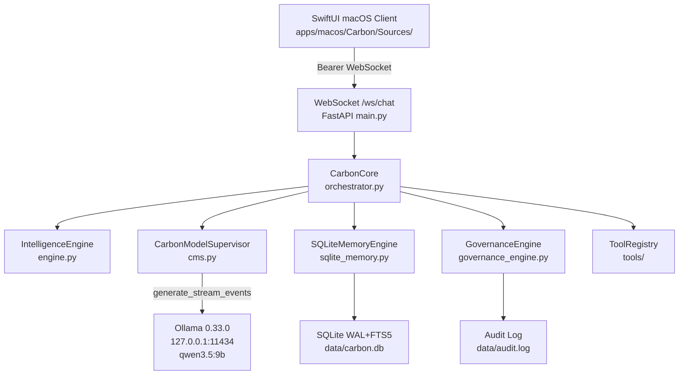

# Carbon

**Local-first personal AI assistant for Apple Silicon macOS.**

Carbon pairs a Python 3.12+ FastAPI backend with a native SwiftUI macOS client, local Ollama inference (`qwen3.5:9b`), and a governed permission system — all running on `127.0.0.1` with no cloud dependency.

> This project is an engineering research platform as much as it is a usable assistant. See [Research Portfolio](docs/research/README.md) and [AI Assistance Disclosure](docs/process/ai-assistance.md).

---

## Architecture



Carbon runs as two cooperating processes:

- **SwiftUI client** (`apps/macos/Carbon`) — single-instance `flock` lock, supervised Ollama/backend startup (`ProcessSupervisor`), Mach memory-pressure monitoring (`MemoryPressureMonitor`), streamed Markdown rendering, and human-in-the-loop Approve/Deny cards.
- **Python backend** (`src/carbon`) — FastAPI + asyncio modular monolith binding strictly to `127.0.0.1:8765`.

For architectural detail see [Architecture Overview](docs/architecture/overview.md), [System Design](docs/architecture/system-design.md), [Data Flow](docs/architecture/data-flow.md), and [Component Contracts](docs/architecture/component-contracts.md).

---

## Implementation Status

| Component | Status | Evidence |
|---|---|---|
| FastAPI server + 24 REST endpoints | **Implemented** | `src/carbon/main.py` (1187 lines) |
| WebSocket `/ws/chat` streaming | **Implemented** | Bearer auth, 10s timeout, 5-connection limit |
| `CarbonCore` orchestrator | **Implemented** | `orchestrator.py` (2324 lines), 86% coverage |
| Intent classification (11-step engine) | **Implemented** | `src/carbon/intelligence/engine.py` |
| Adaptive reasoning (Instant/Standard/Deep) | **Implemented** | `orchestrator.py:1022–1033`; `think` flag |
| CarbonModelSupervisor (CMS) | **Implemented** | `cms.py` (2003 lines), 91% coverage |
| OllamaProvider (`/api/generate`) | **Implemented** | `generate_stream_events`; `qwen3.5:9b` |
| SQLiteMemoryEngine (4-tier, WAL, FTS5) | **Implemented** | `sqlite_memory.py` (1641 lines), 87% coverage |
| GovernanceEngine (P0–P4, A0–A3) | **Implemented** | `governance_engine.py` (560 lines) |
| SHA-256 hash-chained audit log | **Implemented** | Verified chain; `data/audit.log` |
| Telemetry + NIST percentile metrics | **Implemented** | `src/carbon/core/metrics.py` (552 lines) |
| SwiftUI macOS client (7 source files) | **Implemented** | `apps/macos/Carbon/Sources/` |
| ToolRegistry + 3 built-in macOS tools | **Partial** | Registered but not wired into LLM calls |
| DeviceManager (local host info) | **Partial** | `sysctl`+`platform`; Android placeholder |
| Voice pipeline | **Deferred** | `src/carbon/voice/` empty |
| Local embeddings (`IEmbeddingEngine`) | **Planned** | Interface defined; not implemented |
| Android integration | **Planned** | `_connected_nodes` placeholder only |

Full table with evidence links: [docs/STATUS.md](docs/STATUS.md).

---

## Benchmark Results

All results are from verified evidence; none are fabricated. See [Benchmark Methodology](docs/benchmarks/methodology.md) and [Threats to Validity](docs/research/threats-to-validity.md).

### Carbon Orchestration Overhead — FakeProvider (deterministic, N=50)

> Measures Carbon's overhead with zero inference cost. Run with `make test`.

| Metric | P50 | P95 |
|---|---|---|
| Accept → ProviderStart (intent classify + CMS lease) | 1.021 ms | 1.183 ms |
| Accept → Completion (full orchestration) | 1.744 ms | 1.914 ms |
| WS client → first-answer | 1.567 ms | 1.619 ms |

### Live Ollama Inference — `qwen3.5:9b` Q4_K_M (N=100, Oct 2026)

> Source: `benchmarks/inference/results_100_runs.json`. Apple M5, 16 GB, Ollama 0.33.0.

| Metric | P50 | P95 |
|---|---|---|
| First reasoning token (TTFT, warm) | 589 ms | 884 ms |
| Generation speed | 15.1 tok/s | 22.1 tok/s |
| Total end-to-end latency | 11.65 s | 17.81 s |
| Cold start model load | 1.34 s | — |

> **Interpretation:** Carbon orchestration adds < 2 ms P95. Model inference dominates total latency. See [RQ-1](docs/research/questions/latency-decomposition.md) for the full decomposition research question.

---

## Research Portfolio

Carbon is designed around five open research questions in local AI systems engineering:

| ID | Question | Status |
|---|---|---|
| [RQ-1](docs/research/questions/latency-decomposition.md) | Orchestration overhead vs. inference latency | Active (EXP-000 planned) |
| [RQ-2](docs/research/questions/reasoning-depth.md) | Does reasoning depth routing change model behavior? | Planned |
| [RQ-3](docs/research/questions/model-residency.md) | Cold load vs. warm residency overhead | Data available |
| [RQ-4](docs/research/questions/governance-tradeoffs.md) | Latency cost of governance + audit logging | Partial data |
| [RQ-5](docs/research/questions/retrieval-memory.md) | Memory context injection quality vs. latency | Planned |

See [docs/research/README.md](docs/research/README.md) for the full portfolio, [EXP-000 plan](docs/research/experiments/EXP-000-latency-decomposition/plan.md), and [Threats to Validity](docs/research/threats-to-validity.md).

---

## Quickstart

Full instructions: [Development Setup Guide](docs/development/setup.md) and [Testing Guide](docs/development/testing.md).

```bash
# 1. Verify Ollama is installed and qwen3.5:9b is pulled
ollama list | grep qwen3.5:9b

# 2. Create virtual environment and install locked Python dependencies
make setup

# 3. Run lint and offline Python tests (no Ollama required)
make lint
make test

# 4. Build the native macOS SwiftPM client
cd apps/macos/Carbon && swift build
```

For isolated runtime verification without touching `data/carbon.db`, set `CARBON_DATA_DIR`, `CARBON_DATABASE_PATH`, `CARBON_AUDIT_LOG_PATH`, `CARBON_LOCK_PATH`, and `CARBON_API_TOKEN` as documented in the [Setup Guide](docs/development/setup.md#5-isolated-testing-vs-normal-application-use).

---

## Repository Structure

```text
Carbon/
├── README.md                          # This file
├── Makefile                           # setup, test, lint, format, run targets
├── pyproject.toml                     # Package metadata, ruff config, pytest markers
├── requirements.lock                  # Locked Python dependencies
├── apps/macos/Carbon/                 # SwiftPM macOS client (Sources/, Tests/, Package.swift)
├── src/carbon/                        # Python 3.12+ backend
│   ├── main.py                        # FastAPI server + /ws/chat
│   ├── core/                          # CarbonCore orchestrator, logging, metrics
│   ├── intelligence/                  # Intent + reasoning-depth router
│   ├── model_control/                 # CMS, OllamaProvider, FakeProvider
│   ├── memory/                        # SQLiteMemoryEngine (WAL, FTS5, schema v3)
│   ├── governance/                    # Permission ladder, audit log
│   ├── tools/                         # ToolRegistry + built-in macOS tools
│   ├── interfaces/                    # Protocols and Pydantic models
│   └── voice/                         # Empty (deferred)
├── tests/                             # unit/, integration/, security/, performance/
├── benchmarks/                        # Benchmark scripts, raw results, env profile
├── docs/
│   ├── STATUS.md                      # Full implementation status table
│   ├── research/                      # Research portfolio + experiment plans
│   ├── process/                       # AI assistance disclosure
│   ├── architecture/                  # Design docs + ADRs
│   ├── security/                      # Threat model, permissions, privacy
│   ├── benchmarks/                    # Methodology + reports
│   ├── api-reference.md               # REST + WebSocket reference
│   └── reports/                       # Stage verification reports
└── data/                              # Runtime directory (git-ignored)
```

---

## Known Limitations

- **Schema version split:** `data/carbon.db` is on schema v2; fresh/test databases use schema v3. Never migrate or test against `data/carbon.db` without a verified backup.
- **Unbundled executable:** `.build/debug/Carbon` is a SwiftPM binary, not a signed `.app`. Space switching may require selecting the Carbon window explicitly.
- **Swift shutdown test timing race:** `test_shutdown.swift:1287` has an intermittent race when the watchdog fires before child sleep completes.
- **Auth rejections outside audit.log:** `401`/`4401`/`403` rejections at the FastAPI boundary go to stderr, not `audit.log`.
- **Post-outage prewarm:** After Ollama outage, `/api/v1/health` reports `degraded` until the next inference request or `/api/v1/models/refresh`.

---

## Documentation Index

- **Setup & Testing:** [Setup Guide](docs/development/setup.md) | [Testing Guide](docs/development/testing.md) | [Contributing](docs/development/contributing.md)
- **API & Architecture:** [API Reference](docs/api-reference.md) | [Architecture Overview](docs/architecture/overview.md) | [System Design](docs/architecture/system-design.md) | [Data Flow](docs/architecture/data-flow.md) | [ADRs](docs/architecture/adr/)
- **Security:** [Threat Model](docs/security/threat-model.md) | [Permissions](docs/security/permissions.md) | [Privacy](docs/security/privacy.md) | [API Security Review](docs/security/api-security-code-review.md)
- **Benchmarks:** [Methodology](docs/benchmarks/methodology.md) | [Inference Report](docs/benchmarks/inference-benchmark-report.md) | [E2E Latency Report](docs/benchmarks/end-to-end-latency-report.md) | [Hardware Profile](benchmarks/env/hardware-profile.md)
- **Research:** [Research Portfolio](docs/research/README.md) | [EXP-000 Plan](docs/research/experiments/EXP-000-latency-decomposition/plan.md) | [Threats to Validity](docs/research/threats-to-validity.md)
- **Status & Process:** [Implementation Status](docs/STATUS.md) | [AI Assistance Disclosure](docs/process/ai-assistance.md) | [Verification Summary](docs/reports/verification-summary.md)

---

## Responsible AI Disclosure

Carbon was built with substantial AI assistance from Google Antigravity (Gemini). Architecture decisions, project requirements, design principles, and research questions are the project owner's work. See [AI Assistance Disclosure](docs/process/ai-assistance.md) for the full breakdown.

---

## License

This project does not currently carry an open-source license. All rights reserved.
