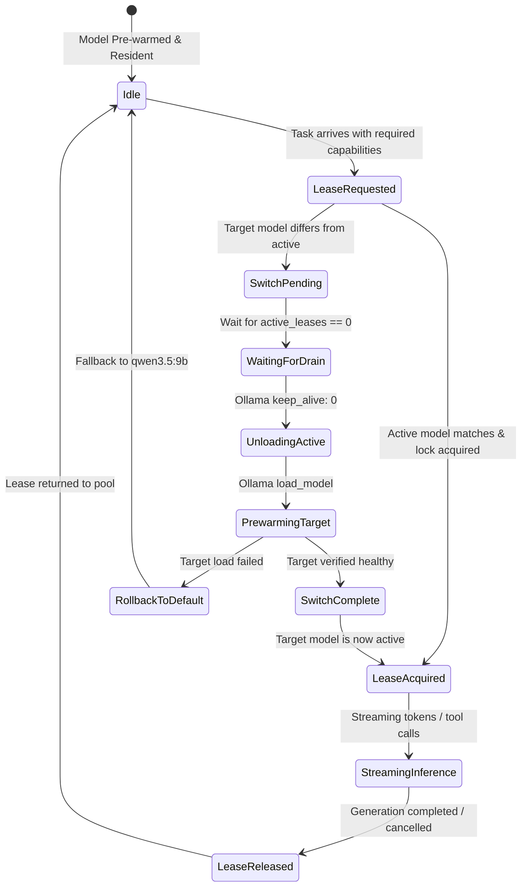

# Carbon Model Supervisor (CMS) — Lifecycle & Switching State Machine

## 1. Architectural Role and Authority

The **Carbon Model Supervisor (CMS)** is the sole, unbypassable authority governing model registration, health monitoring, capability routing, inference lease management, and model lifecycle transitions in Carbon 1.0.0.

In accordance with PRD FR-003 and ADR-0002:
- **Worker Role Invariant:** Individual LLMs are strictly workers. A model has zero authority to select models, unload weights, or trigger tool execution directly.
- **Single Active Chat LLM Invariant:** To prevent memory exhaustion and macOS swap thrashing on 16 GB Apple Silicon unified memory, exactly one chat LLM may hold active inference resources at any given time.
- **Lease Safety Invariant:** Model switching can **never** unload a model while an active inference lease is in progress.

---

## 2. Exclusive Inference Lease Mechanism

CMS mediates all access to the active chat model through an explicit, time-bounded, tokenized **Inference Lease** pattern.



### 2.1 The InferenceLease Contract

```python
class InferenceLease:
    """Tokenized lease conferring temporary right to invoke active chat model."""

    lease_id: str
    task_id: str
    model_id: str
    acquired_at: datetime
    timeout_seconds: float = 60.0
    is_active: bool = True
```

- **Lease Acquisition:** A task calls `cms.acquire_inference_lease(task_id, capabilities, timeout=60.0)`.
- **Atomic Concurrency Tracking:** CMS maintains an atomic `_active_lease_count: int` and an `asyncio.Event` (`_drain_event`) indicating zero active leases.
- **Automatic Revocation & Timeouts:** Every lease is bound by an async timeout (default 60 seconds). If a model fails to complete within the timeout, the lease is forcibly terminated, the upstream connection is aborted, and unified memory is reclaimed.
- **Context Manager Guarantee:** Leases are accessed via an async context manager (`async with cms.lease(task_id): ...`) ensuring unconditional release in `finally` blocks even during unhandled exceptions or cancellations.

---

## 3. Read-Write Concurrency & Model-Switch Lock Interaction

To ensure model switching never unloads a model during active inference while maintaining high responsiveness for sequential tasks, CMS implements a **Fair Read-Write Lock (RWLock)** pattern:

```
┌────────────────────────────────────────────────────────────────────────┐
│                        CMS CONCURRENCY GATE                            │
├───────────────────────────────────┬────────────────────────────────────┤
│ Shared Reader Lock (Inference)    │ Exclusive Writer Lock (Switching)  │
│  - Active model remains resident  │  - Blocks new inference leases     │
│  - Exactly one active chat stream │  - Awaits active_leases == 0       │
│  - Reuses resident Metal buffers  │  - Unloads active weights safely   │
│  - Sub-millisecond lease handoff  │  - Pre-warms target model weights  │
└───────────────────────────────────┴────────────────────────────────────┘
```

### Concurrency Rules & Lock Interaction:

1. **Inference Execution (Reader Lock):**
   - When a task requests inference for the *currently active model*, CMS checks `_switch_pending`. If false, it increments `_active_lease_count`, clears `_drain_event`, and grants the lease.
   - For chat LLMs, single-model concurrency enforces `_max_concurrent_chat_leases = 1`.
2. **Switch Initiation (Writer Lock Request):**
   - When a task demands capabilities absent in the active model, CMS requests a Model Switch.
   - CMS sets `_switch_pending = True`. This immediately prevents any subsequent inference tasks from acquiring leases on the old model.
3. **Active Lease Drain:**
   - CMS awaits `_drain_event.wait()` with a strict drain timeout (default 10 seconds).
   - If the active inference finishes normally, `_active_lease_count` reaches 0, triggering `_drain_event`.
   - If the drain timeout expires, CMS issues an upstream cancellation signal to the active task, aborting the stream and freeing the lease.
4. **Model Unload & Swap:**
   - With `_active_lease_count == 0` guaranteed, CMS enters the critical section:
     1. Command Ollama to unload active model (`POST /api/generate` with `keep_alive: 0`).
     2. Verify unified memory release via host memory telemetry.
     3. Command Ollama to load and pre-warm target model.
     4. Verify target model health probe (`/api/version` and `/api/tags`).
     5. Update `_active_model = target_model`.
     6. Clear `_switch_pending = False`.
     7. Release writer lock and grant pending leases to queued tasks.

---

## 4. Request Queuing, Cancellation, and Checkpointing

### 4.1 Request Queuing
Inbound tasks are enqueued in an in-memory priority queue (`asyncio.PriorityQueue`):
- **Priority 0 (Urgent/Interactive):** Active conversational prompt, user barge-in cancellation.
- **Priority 1 (Standard):** User task execution, standard reasoning request.
- **Priority 2 (Background):** Semantic memory consolidation, background health probes.

### 4.2 Cancellation Mechanics
- Every task maintains an `asyncio.Event` cancellation token.
- If the user cancels via UI or voice barge-in:
  1. Core sets `task.cancel_event.set()`.
  2. The active HTTP streaming socket to Ollama is closed immediately (`client.aclose()`).
  3. The active inference lease is released in the `finally` block.
  4. CMS state machine resets to `IDLE`.

### 4.3 Checkpointing Protocol
For multi-step autonomous tasks (Autonomy A2/A3):
- Before dispatching a tool call or model reasoning step, Core serializes the task state (`TaskRecord`) to SQLite (`tasks` table) with status `CHECKPOINTED`.
- If an unexpected backend interruption occurs, incomplete tasks can be resumed or cleanly rolled back upon startup without orphaned side effects.

---

## 5. Failure Recovery Matrix

| Failure Mode | Detection Trigger | Recovery Procedure |
|---|---|---|
| **Active Inference Timeout** | Execution exceeds `inference_timeout_seconds` (60s). | Forcibly cancel HTTP stream; release inference lease; record timeout event in audit log; return structured timeout error to client. |
| **Model Unloading Failure** | Ollama `/api/generate` with `keep_alive: 0` returns non-200 or times out. | Retry unload up to 3 times with exponential backoff (1s, 2s, 4s). If unload still fails, **abort the model switch** to prevent running two models concurrently and crashing host memory. Keep previous model active and log critical audit alert. |
| **Target Model Loading Failure** | Ollama fails to pre-warm target model within 15 seconds. | Abort switch; trigger automated rollback to primary approved model (`qwen3.5:9b`); reload primary model; return error notice to user explaining capability failure. |
| **Ollama Daemon Crash / Disconnect** | Network socket to `127.0.0.1:11434` refused or connection reset. | CMS transitions to `OFFLINE` state; dispatches `SYSTEM_DEGRADED` event to UI; attempts automatic reconnection every 3 seconds; blocks all new lease acquisitions until health probe passes. |
| **Host Memory Pressure Warning** | macOS `kern.memorystatus_vm_pressure_level` reaches 2 (Warning) or 4 (Critical). | CMS immediately unloads idle specialist models; flushes KV cache by setting `keep_alive: 0` on completion; temporarily caps max context window to 8,192 tokens; rejects deep reasoning tasks until pressure returns to 1 (Normal). |
