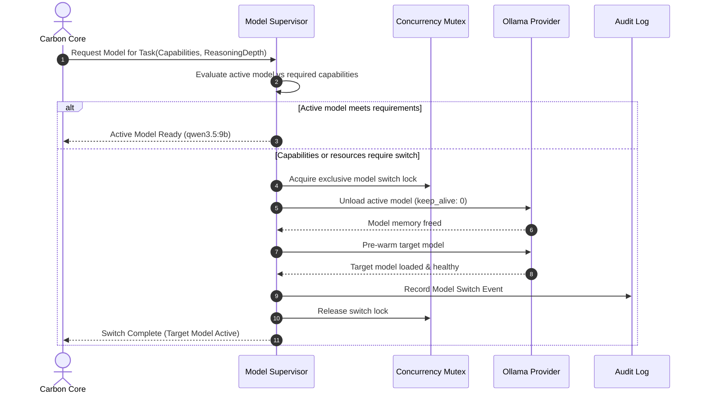
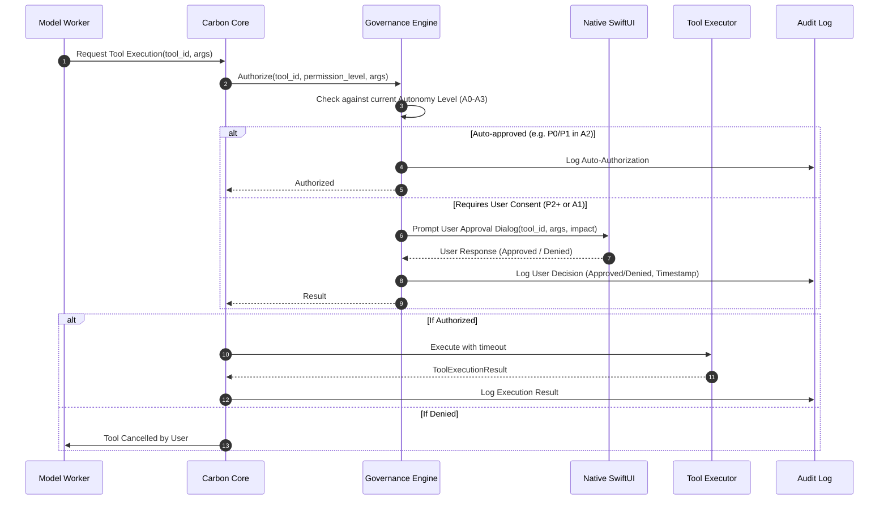

# Carbon Data Flow & Execution Lifecycle

## 1. End-to-End User Interaction Flow

```
[User Input] (Native macOS GUI or Voice STT)
      │
      ▼
[Carbon Loopback API] (FastAPI: /api/v1/chat or WebSocket /ws/chat)
      │
      ▼
[Carbon Core Orchestrator]
      │
      ├─► [Memory Engine] Query working/semantic memory for context
      │
      ├─► [Intelligence Engine]
      │         ├─ Intent Classification & Complexity Estimation
      │         └─ Select Reasoning Depth: Instant | Standard | Deep
      │
      ├─► [Carbon Model Supervisor (CMS)]
      │         ├─ Validate active model capabilities
      │         ├─ If mismatch: Trigger Controlled Model Switch
      │         └─ Acquire Single-Model Inference Lease (Mutex)
      │
      ├─► [Model Provider: Ollama (Qwen 3.5 9B)]
      │         ├─ Stream tokens back to Core
      │         └─ Parse structured action calls (if any)
      │
      ▼ (If tools requested)
[Governance Engine]
      ├─ Evaluate Permission Level (P0..P4) vs Autonomy Level (A0..A3)
      ├─ If P2+: Dispatch Confirmation Request to Native UI
      └─ Write decision to append-only Audit Log
      │
      ▼ (Upon Authorization)
[Tool Execution Engine]
      ├─ Validate arguments against Pydantic schema
      ├─ Run tool in bounded async sandbox with timeout
      └─ Return ToolExecutionResult to Core -> Re-prompt Model
      │
      ▼
[Response Finalization]
      ├─ Write episodic record to SQLite Memory
      ├─ Stream final response tokens to SwiftUI UI
      └─ Release CMS Inference Lease
```

---

## 2. Model Switching Sequence



---

## 3. Tool Authorization & Governance Flow


