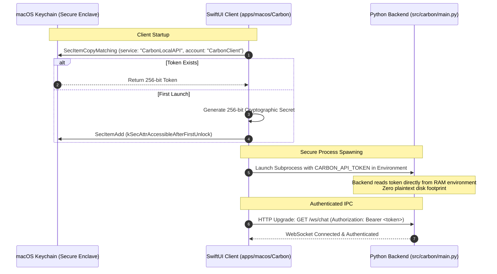

# Carbon 1.0.0 — macOS Keychain Implementation Status & Production Migration Plan

**Document Date:** 2026-10-28  
**Author:** Google Antigravity (Primary Development Agent)  
**Status:** Architecture Specified (ADR-0007) — Code Implementation Scheduled for Phase 2  
**Current Secret Storage Mechanism:** POSIX `0600` Local File (`data/.carbon_token`)  

---

## 1. Formal Confirmation of Implementation Status

> [!IMPORTANT]
> **Definitive Status Confirmation:**
> macOS Keychain integration is **NOT yet implemented in code**. It is currently **documented and architected in ADR-0007**. 
>
> In strict accordance with the development directive, Carbon does **not** falsely claim Keychain protection is complete in the current repository codebase.

---

## 2. Review of Current Development Secret Storage

The Phase 1 foundation utilizes a file-based token mechanism:
- **Location:** `data/.carbon_token`
- **Entropy:** 256 bits generated via `secrets.token_urlsafe(32)`.
- **Permissions:** POSIX `0600` (`-rw-------`) enforced via `os.chmod(token_path, 0o600)` and atomic write flags (`O_CREAT | O_WRONLY | O_TRUNC`).
- **Rotation:** Supported via `POST /api/v1/auth/rotate-token`, which atomically updates the file and server runtime memory.

### Security Deficiencies of POSIX 0600 vs. macOS Keychain

| Security Dimension | Current POSIX 0600 Storage | Native macOS Keychain (`Security.framework`) | Real-World Vulnerability |
| :--- | :--- | :--- | :--- |
| **UID Process Isolation** | **None.** Any process executing under `UID=501` can read the token. | **Enforced.** Isolated against all processes lacking code-signing entitlements. | On a developer MacBook Air, rogue npm/pip scripts, browser extensions, or malicious user-space binaries running as the user can read `data/.carbon_token`. |
| **Hardware Encryption** | **None.** Plaintext on NVMe. | **Enforced.** Hardware-backed AES-256 via Apple Silicon Secure Enclave. | In unencrypted local backups or offline disk dumps (if FileVault is unmounted/bypassed), the token is exposed in plaintext. |
| **Binary Identity (ACL)** | **None.** No signature checks. | **Enforced.** macOS checks code-signing signature and matching bundle identifier (`com.antigravity.carbon`). | POSIX permissions cannot distinguish between Carbon's official binary and an untrusted script. |

> [!CAUTION]
> POSIX `0600` is **NOT equivalent to Keychain protection**. It provides multi-user Unix isolation, but zero intra-user process isolation on a single-user macOS desktop.

---

## 3. Retained Development Approach for Phase 1

For the remainder of Phase 1 foundation verification, Carbon retains `data/.carbon_token` with POSIX `0600` permissions strictly as a **developer bootstrap and headless testing mechanism**. 

**Rationale:**
1. Headless integration test suites (`pytest`, `TestClient`) run in terminal environments without triggering macOS GUI Keychain authorization prompts.
2. It avoids introducing unnecessary external Python C-bindings (`pyobjc-framework-Security` or `keyring`) which violate the dependency freeze.
3. Network exposure is strictly blocked by loopback-only binding (`127.0.0.1:8765`) and rejection of external origins and `Origin: null`.

---

## 4. Phase 2 Production Migration Plan

The transition to native hardware-backed macOS Keychain Services will be executed in Phase 2 using a **Dual-Custody Handshake Architecture**:

### Phase 2 Implementation Steps:
1. **Swift Keychain Module (`KeychainHelper.swift`):**
   - Implement `KeychainHelper` in `apps/macos/Carbon/Sources/KeychainHelper.swift` using native `Security` framework.
   - Use `kSecClassGenericPassword` with `kSecAttrService = "CarbonLocalAPI"` and `kSecAttrAccount = "CarbonDesktopClient"`.
   - Set accessibility to `kSecAttrAccessibleAfterFirstUnlock`.
2. **Subprocess Token Injection:**
   - When the SwiftUI application launches the Python backend, pass the secret via the environment variable `CARBON_API_TOKEN` or an anonymous Unix pipe (`pipe()`).
3. **Elimination of Disk Footprint:**
   - In production mode (`CARBON_ENV=production`), remove file writing from `_get_or_create_token()`. The backend will demand token delivery via environment variable; if missing, it halts with an error.
4. **Token Rotation Synchronization:**
   - When `POST /api/v1/auth/rotate-token` is invoked, the client updates the Keychain item via `SecItemUpdate` and immediately updates its active connection headers.
