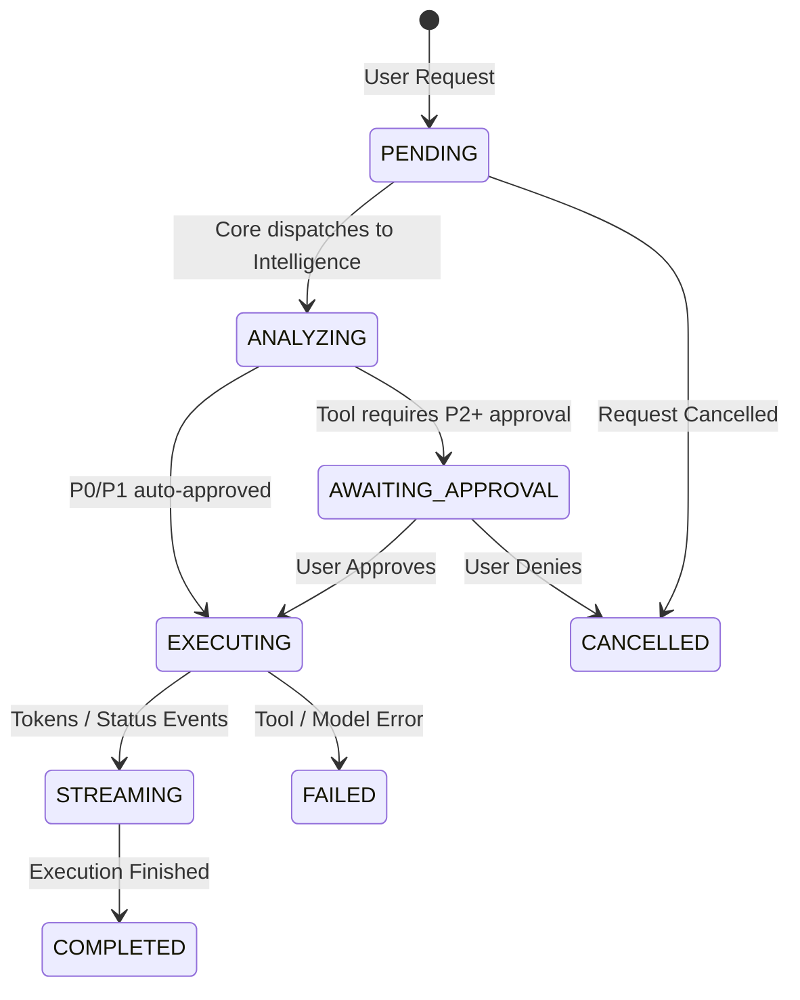

# Carbon System Design

## 1. System Topology

Carbon operates as a cooperating pair of processes running locally on macOS:

1. **Carbon Desktop Frontend (SwiftUI):** Native macOS GUI and menu-bar application managing UI events, audio I/O, native dialogs, and user input.
2. **Carbon Core Backend (Python 3.12+):** Async service managing orchestration, intelligence, CMS, memory, governance, and tools.

Inter-process communication (IPC) is conducted exclusively over loopback TCP (`127.0.0.1`) using HTTP/REST for state queries/actions and WebSocket/SSE for real-time bi-directional streaming.

---

## 2. Subsystem Deep Dive

### 2.1 Carbon Core (Orchestrator)

The Core Orchestrator is the central nervous system of Carbon.

- **Lifecycle Coordinator:**
  - Performs dependency order startup: Config -> Database/WAL -> Audit Logger -> Model Registry & CMS -> Memory Engine -> Governance Engine -> Tool Registry -> Device Engine -> API Server.
  - Intercepts POSIX signals (`SIGINT`, `SIGTERM`) to trigger clean drain and shutdown, closing active client sockets, flushing database WAL commits, and releasing model locks.
- **Task Management State Machine:**
  - Tasks represent discrete user instructions or workflows.
  - States: `PENDING` -> `ANALYZING` -> `AWAITING_APPROVAL` -> `EXECUTING` -> `STREAMING` -> `COMPLETED` | `FAILED` | `CANCELLED`.
  - Tasks maintain immutable context, execution history, and cancellation tokens.

---

### 2.2 Carbon Model Supervisor (CMS)

CMS is the sole authority governing model selection, verification, and lifecycle.

- **Model Registry:**
  - Maintains metadata on verified local and remote models (Family, parameters, quantization, context length, capabilities, resource requirements).
  - Actively polls provider health via automated probes.
- **Single-Model Concurrency Gate:**
  - Utilizes an asynchronous mutual exclusion lock (`asyncio.Lock`) preventing concurrent chat LLM inferences.
  - Protects the 16 GB Apple Silicon unified memory pool from memory pressure events and thermal throttling.
- **Switching Engine:**
  - If a task demands capabilities beyond the currently loaded model (e.g. specialized coding, vision, or larger context), CMS orchestrates an explicit switch.
  - Unloads the active model via provider hooks (`keep_alive: 0` in Ollama).
  - Verifies host memory headroom before issuing warm-up load commands for the target model.
  - Fallback logic: If the target model fails to respond within a timeout threshold, CMS gracefully rolls back to the approved default (`qwen3.5:9b`).

---

### 2.3 Intelligence Engine

The Intelligence Engine bridges human language and computational execution.

- **Intent & Complexity Assessment:**
  - Fast-path heuristic and model-guided classification of user queries into categories: `CONVERSATIONAL`, `FACTUAL_QUERY`, `SYSTEM_COMMAND`, `MULTI_STEP_PLAN`.
  - Determines required reasoning depth:
    - **Instant:** Direct responses without chain-of-thought, low latency (< 1s first-token target).
    - **Standard:** Single-stage reasoning, structured answers.
    - **Deep:** Explicit thinking phase enabled (`qwen3.5:9b` native thinking block), multi-step verification.
- **Task Planner:**
  - For complex tasks, constructs an execution plan with discrete tool actions.
  - Formats instructions using constrained prompt templates ensuring deterministic JSON tool-call schema conformance.
- **Output Validator:**
  - Parses and validates LLM generation against expected schemas before dispatching actions to Carbon Core.
  - Filters malformed hallucinations or unapproved action requests.

---

### 2.4 Persistent Memory Engine

Memory is organized across four distinct functional categories stored in local SQLite tables:

1. **Working Memory:** In-memory + fast-cached task context for the active session. Flushed upon task termination or reset.
2. **Episodic Memory:** Chronological records of past user conversations, executed actions, and outcomes. Indexed by timestamp and conversation ID.
3. **Semantic Memory:** Stable user preferences, profiles, project contexts, and verified facts.
4. **Procedural Memory:** Reusable multi-step workflows, tool call templates, and system operation recipes.

- **Retention & Forgetting:**
  - Implements a privacy-first retention policy.
  - User can execute explicit forgetting commands ("Forget what I said about...", "Clear my work history from today").
  - Automated relevance decay avoids prompt bloat and unnecessary retrieval overhead.

---

### 2.5 Governance & Permissions Engine

The Governance Engine serves as Carbon's security perimeter.

- **Permission Tiers:**
  - **P0 (Conversational):** Read-only factual chat, system status query. No side effects.
  - **P1 (Read Approved):** Read permitted application state, list active windows, check system metrics.
  - **P2 (Reversible Execution):** Launch approved macOS applications, switch workspace, copy to clipboard.
  - **P3 (State Modification):** Modify files, update settings, send network requests, trigger calendar entries. Requires explicit user confirmation dialog.
  - **P4 (High-Impact / Destructive):** File deletion, credential operations, system restarts. Requires explicit double-confirmation or hard prohibition.
- **Autonomy Levels:**
  - **A0 (Observe):** Carbon only observes and answers; no tool executions permitted.
  - **A1 (Assist & Recommend):** Carbon generates action plans and presents them to the user for one-click approval. (Default mode).
  - **A2 (Execute Approved):** Carbon automatically executes P0–P2 operations; requests approval only for P3+.
  - **A3 (Bounded Autonomy):** Carbon autonomously executes multi-step plans within strict pre-declared policy boundaries and limits.

---

### 2.6 Tool Execution Framework

All external computer interactions occur strictly through registered tools implementing the `BaseTool` contract:

- **Strict Validation:** Every tool inputs and outputs must adhere to a Pydantic `BaseModel` schema.
- **Isolated Execution:** Tools execute in isolated async worker tasks with configurable timeouts (default 10s).
- **Audit Logging:** Every tool request, authorization status, parameter set, return value, and execution duration is cryptographically hashed and logged to `data/audit.log`.

---

### 2.7 Device Engine

Manages the local host environment and prepares for multi-device topology:

- **Local Mac Node:** Inspects macOS hardware capabilities, battery state, thermal throttling status, and available unified memory.
- **Connected Node Protocol (Future):** Pre-defines cryptographic handshake interfaces, mutual TLS, and capability negotiation for companion Android devices (Samsung Galaxy S23 FE).
