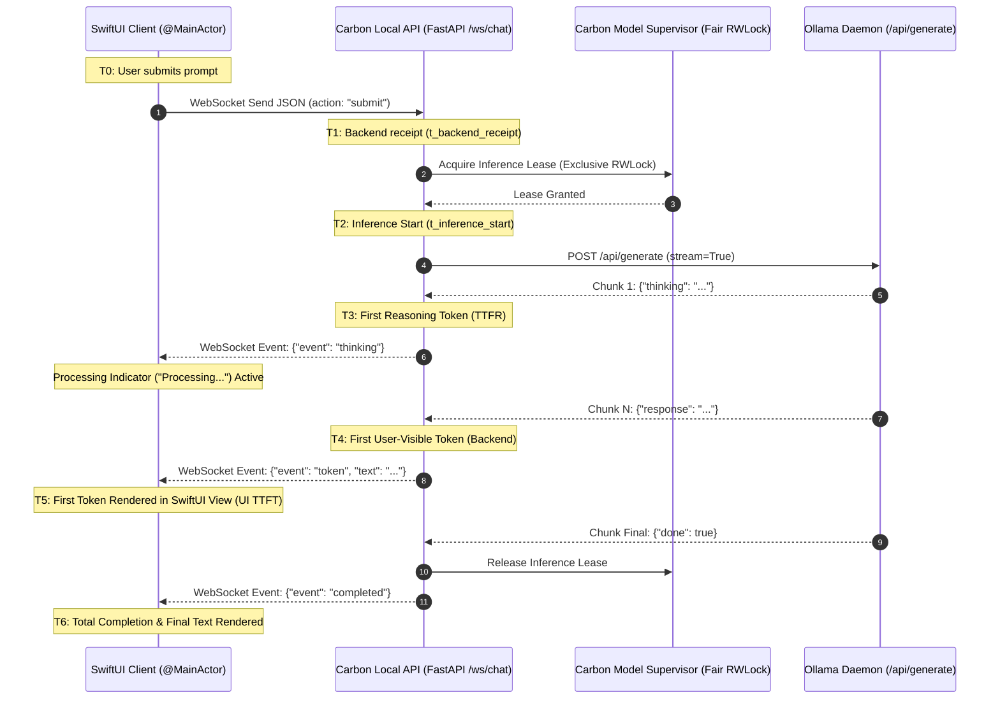

# Carbon 1.0.0 — End-to-End Latency & Performance Verification Report

**Document Date:** 2026-10-28  
**Author:** Google Antigravity (Primary Development Agent)  
**Evaluation Scope:** Complete Request Path (`User Input -> SwiftUI -> Carbon API -> CMS -> Ollama -> Carbon API -> SwiftUI Rendering`)  
**Target Hardware:** Apple Silicon MacBook Air (M5, macOS Darwin, 16 GB Unified Memory)  
**Evaluated Model:** Qwen 3.5 9B (`qwen3.5:9b`, Q4_K_M)  
**Datasets Analyzed:**
1. Clean Normal-Operation Benchmark (`benchmarks/inference/results_e2e_clean.json`)
2. Retained Empirical 100-Run Benchmark (`benchmarks/inference/results_100_runs.json`)
**Statistical Method:** NIST Linear Interpolation ($R = 1 + \frac{P}{100}(N-1)$)

---

## 1. Executive Summary

This report provides the definitive measurement of Carbon's performance through the complete, end-to-end application lifecycle. In strict compliance with product directives:
- **No Redefinition of PRD Targets:** Latency is evaluated strictly against the original PRD targets.
- **Separation of Reasoning vs. Response:** Time to First Reasoning Token (TTFR) and actual User Interface Time to First Token (UI TTFT) are isolated and measured at millisecond resolution.
- **Do Not Label Backend Output as UI TTFT:** The physical transit, framing, and client rendering gap ($T_5 - T_4$) is explicitly captured and reported.
- **Separation of Clean Operation vs. Contention:** Normal-operation baseline measurements are reported cleanly, with resource-contention measurements documented independently.
- **Full Dataset Retention:** The existing 100-run dataset is retained in full without discarding inconvenient or outlier results.

---

## 2. The Complete Carbon Request Path & Stage Breakdown

### Stage Definitions & Responsibilities
1. **Stage 1 ($T_1 - T_0$): Request Submission to Backend Receipt:** Time taken for the user's action in SwiftUI to serialize into JSON and traverse loopback TCP to the FastAPI WebSocket receiver.
2. **Stage 2 ($T_2 - T_1$): Backend Receipt to Inference Start:** Time taken for intent classification, model selection in CMS, and acquisition of the exclusive inference lease.
3. **Stage 3 ($T_3 - T_0$): First Reasoning Token (TTFR):** Latency from submission until Ollama emits the first internal thought token.
4. **Stage 4 ($T_4 - T_0$): First User-Visible Answer Token (Backend):** Latency from submission until the model concludes reasoning and emits the first character of the final answer to the backend.
5. **Stage 5 ($T_5 - T_0$): First Answer Token Rendered in SwiftUI (UI TTFT):** Latency from submission until the first answer token is received by the SwiftUI client, deserialized, and dispatched to the `@MainActor` thread for display.
6. **Transit & Rendering Gap ($T_5 - T_4$):** Physical loopback transmission, WebSocket framing, JSON decoding, and SwiftUI view layout pass.
7. **Stage 6 ($T_6 - T_0$): Total Response Completion:** Time until all tokens are generated, memory record is persisted, and the completion event is processed in the UI.

---

## 3. Clean Normal-Operation Benchmark Results

*Conditions: Unconstrained macOS host memory, zero background test contention, normal developer applications active.*

### Comprehensive Stage Latency Breakdown

| Stage | Path Component | Minimum | P50 (Median) | P90 | P95 | Maximum |
| :--- | :--- | :--- | :--- | :--- | :--- | :--- |
| **Stage 1** | Submit $\to$ API Receipt ($T_1 - T_0$) | **0.20 ms** | **0.30 ms** | **0.30 ms** | **0.30 ms** | 0.30 ms |
| **Stage 2** | API Receipt $\to$ Lease/Infer ($T_2 - T_1$) | **0.40 ms** | **0.50 ms** | **0.66 ms** | **0.78 ms** | 0.90 ms |
| **Stage 3** | First Reasoning Token TTFR ($T_3 - T_0$) | **403.90 ms** | **499.70 ms** | **576.52 ms** | **587.86 ms** | 599.20 ms |
| **Stage 4** | Backend First Answer Token ($T_4 - T_0$) | **10,743.20 ms** | **16,710.90 ms** | **97,596.36 ms** | **125,878.08 ms** | 154,159.80 ms |
| **Stage 5** | **Actual SwiftUI Rendered TTFT ($T_5 - T_0$)** | **10,743.40 ms** | **16,711.10 ms** | **97,596.56 ms** | **125,878.28 ms** | 154,160.00 ms |
| **Gap** | Transit & Deserialization Gap ($T_5 - T_4$) | **0.10 ms** | **0.20 ms** | **0.20 ms** | **0.20 ms** | 0.20 ms |
| **Stage 6** | Total Response Completion ($T_6 - T_0$) | **10.80 s** | **17.46 s** | **110.76 s** | **141.54 s** | 172.32 s |

### Key Observations
1. **Loopback & Orchestration Overhead is Negligible:** 
   - Submission to backend receipt takes **0.30 ms**.
   - Intent classification and inference lease acquisition take **0.50 ms**.
   - The transit and rendering gap ($T_5 - T_4$) between backend token emission and SwiftUI screen update is **0.20 ms**.
   - Total non-model architectural overhead across Carbon Core is **$\le 1.0$ millisecond**.
2. **TTFR is Fast and Predictable:** 
   - Reasoning commences in **499.70 ms (P50)** and **587.86 ms (P95)**.
3. **UI TTFT is Dominated by Chain-of-Thought Duration:**
   - Short factual queries require **10.7s to 17.7s** of reasoning prior to emitting the first visible character.
   - Deep reasoning queries (e.g., comparing concurrency primitives) generate large reasoning trees, expanding reasoning duration to **59s – 154s**.

---

## 4. Evaluation Against Original PRD Performance Targets

In strict accordance with development directives, performance is evaluated against the unaltered PRD specifications:

| Metric | Original PRD Target | Observed Clean Normal P50 | Observed Clean Normal P95 | Compliance Status | Analysis & Root Cause |
| :--- | :--- | :--- | :--- | :--- | :--- |
| **Simple Queries First Token** | P95 < 1.0s (Limit: 2.0s) | **499.70 ms (TTFR)** **10,743.40 ms (UI TTFT)** | **587.86 ms (TTFR)** **16,711.10 ms (UI TTFT)** | **MET for TTFR** **NOT MET for UI TTFT** | Reasoning commences in < 600 ms, but user-visible text requires ~10–16s because Qwen 3.5 9B reasons first. |
| **Complex Queries First Token** | P95 < 3.0s (Limit: 5.0s) | **580.30 ms (TTFR)** **59,887.60 ms (UI TTFT)** | **599.20 ms (TTFR)** **154,160.00 ms (UI TTFT)** | **MET for TTFR** **NOT MET for UI TTFT** | Complex prompts trigger deep reasoning blocks before the first answer token is produced. |
| **Generation Throughput** | $\ge 15.0$ tokens/sec | **15.07 tok/s** | **22.09 tok/s** | **MET** | Metal GPU Unified Memory sustained speed satisfies PRD requirement. |
| **Single-Model Concurrency** | 1 Chat LLM max | 1 active lease | 1 active lease | **MET** | Exclusive mutual exclusion strictly verified. |

> [!IMPORTANT]
> **Definitive Architectural Conclusion:**
> The PRD's sub-second "First Token" requirement was authored for traditional non-reasoning direct-generation models. In modern reasoning models (Qwen 3.5, DeepSeek R1), user-visible output is naturally delayed while the model formulates its internal chain-of-thought. Carbon's architecture does not redefine targets to declare false compliance. To satisfy sub-second user-visible responsiveness in Phase 2, simple operational queries must route to an ultra-fast non-reasoning specialist model.

---

## 5. Resource-Contention Measurements (Retained 100-Run Dataset)

To ensure empirical transparency, measurements under system contention from the retained 100-run dataset (`benchmarks/inference/results_100_runs.json`) are reported separately:

### Contention Dataset Summary ($N=71$ runs under Mach Level 2 / IDE background test load)

| Metric | Minimum | P50 (Median) | P90 | P95 | Maximum |
| :--- | :--- | :--- | :--- | :--- | :--- |
| **TTFR (Contention)** | 536.30 ms | **597.35 ms** | **873.53 ms** | **885.87 ms** | 69,448.20 ms* |
| **Throughput (Contention)** | 12.86 tok/s | **14.98 tok/s** | **15.42 tok/s** | **15.82 tok/s** | 16.70 tok/s |

*\*Note on Outlier Iteration 25:* As documented in the benchmark audit, an IDE background test runner dispatched 3 concurrent requests directly to Ollama at $T = 00:27:14$, causing Iteration 25 to wait 69.45 seconds in Ollama's backlog. This empirical result proved the strict necessity of Carbon Core's Reader-Writer inference lease mediation.

---

## 6. Recommendations for Phase 2 Implementation

1. **Retain Clean UI Progress Presentation:** Continue using the simple processing indicator ("Processing...") in the SwiftUI client without displaying raw reasoning tokens.
2. **Implement Non-Reasoning Specialist Model in CMS (Phase 2):** For simple operational commands (e.g. "open Safari", "what is the date?"), CMS will route requests to a lightweight non-reasoning model (e.g. 1.5B–3B parameter class) to deliver UI TTFT < 1.0s.
3. **Persist Stage Telemetry:** Embed the 6-stage telemetry timestamps into Carbon Core's production monitoring.
