# Carbon 1.0.0 — Inference Benchmark Report (N=100)

**Document Type:** Formal Performance Benchmark & Evaluation  
**Version:** 1.3.0  
**Status:** Complete — Empirical Verification  
**Target Hardware:** Apple Silicon MacBook Air (M5, macOS Darwin, 16 GB Unified Memory)  
**Evaluated Model:** Qwen 3.5 9B (`qwen3.5:9b`, Q4_K_M, 9.0B parameters)  
**Model Runtime:** Local Ollama Daemon (`http://127.0.0.1:11434`)  
**Percentile Method:** NIST Linear Interpolation ($R = 1 + \frac{P}{100}(N-1)$)

---

## 1. Executive Summary

This benchmark presents the rigorous statistical evaluation of 100 consecutive warm inference iterations on Carbon 1.0.0, fulfilling all requirements of the Phase 0 / Phase 1 Final Readiness Gate.

### Critical Metric Clarification: TTFR vs. TTFT_resp
In accordance with product directives, **First Reasoning Token (TTFR)** and **First User-Visible Response Token (TTFT_resp)** are measured and reported separately:
- **TTFR (Time To First Reasoning Token):** Measures latency until the model begins emitting internal thoughts within the `<think>` block.
- **TTFT_resp (Time To First User-Visible Response Token):** Measures latency until the model finishes reasoning and emits the first character displayed to the end user.

### PRD Target Compliance Verdict

| Metric | PRD Target | Observed P50 | Observed P95 | Compliance Status | Rationale |
| :--- | :--- | :--- | :--- | :--- | :--- |
| **TTFR (Reasoning Start)** | P95 < 1.0s (Simple) P95 < 3.0s (Complex) | **589.15 ms** | **883.74 ms** | **MET** | Warm KV cache and Unified Memory enable sub-second reasoning initiation across all prompts. |
| **TTFT_resp (User-Visible Start)** | P95 < 1.0s (Simple) P95 < 3.0s (Complex) | **5,991.93 ms** | **13,911.23 ms** | **NOT MET** | Qwen 3.5 9B reasoning blocks require 50–150 tokens (~5–14s) of chain-of-thought prior to emitting user text. |
| **Generation Speed** | $\ge 15$ tokens/sec | **15.07 tok/s** | **22.09 tok/s** | **MET** | Metal GPU Unified Memory achieves sustained 15.07–22.26 tok/s. |
| **Single-Model Concurrency** | 1 Chat LLM max | 1 active lease | 1 active lease | **MET** | CMS mutual exclusion strictly enforced. |

> [!IMPORTANT]
> **Definitive Architectural Finding:** The PRD's original sub-second "First Token" target was authored assuming non-reasoning direct-response LLMs. For modern reasoning models like Qwen 3.5, while internal reasoning commences in **~589 ms**, user-visible text requires **~6.0s**. To maintain sub-second user-visible responsiveness in Phase 2, Carbon's UI must stream reasoning tokens in a collapsed disclosure block or utilize a dedicated non-reasoning specialist model for greetings/simple queries.

---

## 2. Benchmark Methodology & Statistical Rigor

### Sample Size & Execution
- **Warm Iterations:** 100 consecutive requests executed via Carbon's CMS orchestrator pipeline.
- **Cold Baseline:** 1 cold load established by forcefully evicting model (`keep_alive: 0`) and measuring initial load.
- **Percentile Formula:** NIST Linear Interpolation:
  $$R = 1 + \frac{P}{100}(N-1)$$
  Given sorted values $V_1, V_2, \dots, V_N$, the $P$-th percentile is $V_k + d(V_{k+1} - V_k)$, where $k = \lfloor R \rfloor$ and $d = R - k$.

### Prompt Categorization
To prevent prompt-length bias, requests were alternated 50/50 between two distinct workload categories:
1. **Short Prompts ($N=50$, $\sim$10–30 input tokens):** Direct factual queries, system status checks, short calculations (e.g., *"What is the capital of France? Answer in one word."*).
2. **Long Prompts ($N=50$, $\sim$80–180 input tokens):** Architecture summaries, multi-step code reviews, analytical explanations (e.g., *"Explain the architectural tradeoffs between POSIX file token storage and macOS Keychain Services..."*).

---

## 3. Comprehensive Statistical Results

### Overall Summary (N=100)

| Metric | Minimum | P50 (Median) | P90 | P95 | Maximum |
| :--- | :--- | :--- | :--- | :--- | :--- |
| **TTFR (First Reasoning)** | 301.48 ms | **589.15 ms** | **871.59 ms** | **883.74 ms** | 69,448.20 ms* |
| **TTFT_resp (First Visible Response)** | 4,457.21 ms | **5,991.93 ms** | **10,741.55 ms** | **13,911.23 ms** | 17,080.90 ms |
| **Generation Speed** | 12.86 tok/s | **15.07 tok/s** | **18.53 tok/s** | **22.09 tok/s** | 22.26 tok/s |
| **Total Turnaround Time** | 5.69 s | **11.65 s** | **17.71 s** | **17.81 s** | 77.51 s* |

*\*Note: Maximum values reflect empirical resource-contention outlier at Iteration 25, detailed below.*

---

## 4. Normal Operation vs. Resource Contention

Measurements were categorized dynamically based on host Mach kernel memory pressure levels:

### A. Normal Operation (Level 1 Normal, $N=29$)
*Conditions: Unconstrained macOS host memory, zero background test contention.*

| Metric | Min | P50 (Median) | P90 | P95 | Max |
| :--- | :--- | :--- | :--- | :--- | :--- |
| **TTFR** | 301.48 ms | **405.94 ms** | **565.66 ms** | **587.80 ms** | 608.54 ms |
| **Generation Speed** | 15.10 tok/s | **21.50 tok/s** | **22.18 tok/s** | **22.25 tok/s** | 22.26 tok/s |

*Under unconstrained conditions, TTFR averages ~400 ms with generation throughput exceeding 21 tokens/second.*

### B. Resource Contention (Level 2 Warning & Concurrent Workload, $N=71$)
*Conditions: Mach kernel memory pressure warning, active browser / IDE processes, concurrent test execution.*

| Metric | Min | P50 (Median) | P90 | P95 | Max |
| :--- | :--- | :--- | :--- | :--- | :--- |
| **TTFR** | 536.30 ms | **597.35 ms** | **873.53 ms** | **885.87 ms** | 69,448.20 ms* |
| **Generation Speed** | 12.86 tok/s | **14.98 tok/s** | **15.42 tok/s** | **15.82 tok/s** | 16.70 tok/s |

*Under Level 2 memory pressure, TTFR increases by ~190 ms (P50 = 597 ms), and throughput stabilizes around 15.0 tok/s.*

---

## 5. Workload Breakdown by Prompt Category

```mermaid
gantt
    title Latency Breakdown: Reasoning Phase vs Response Generation
    dateFormat X
    axisFormat %s s
    section Short Prompts
    TTFR (Reasoning Start) : 0, 1
    Reasoning / Thinking Phase (50-90 tokens) : 1, 6
    User-Visible Response : 6, 8
    section Long Prompts
    TTFR (Reasoning Start) : 0, 1
    Reasoning / Thinking Phase (150-220 tokens) : 1, 12
    User-Visible Response : 12, 17
```

| Prompt Category | Sample Size | TTFR P50 | TTFR P90 | TTFR P95 | Total Latency P50 | Total Latency P95 |
| :--- | :--- | :--- | :--- | :--- | :--- | :--- |
| **Short Prompts** | 50 | **573.03 ms** | **846.29 ms** | **865.25 ms** | **8.49 s** | **8.90 s** |
| **Long Prompts** | 50 | **600.24 ms** | **874.77 ms** | **881.75 ms** | **17.27 s** | **18.04 s** |

- **Short Prompts:** TTFR P95 is **865.25 ms**, satisfying the < 1.0s target for prompt processing. Total execution is dominated by ~90–110 reasoning tokens.
- **Long Prompts:** TTFR P95 is **881.75 ms**. Total latency averages **17.27 s** due to complex chain-of-thought expansion (~220 reasoning tokens).

---

## 6. Cold Start Performance Baseline

To measure cold model loading from NVMe storage into Apple Silicon Unified Memory:
1. `qwen3.5:9b` was evicted via `POST /api/generate {"model": "qwen3.5:9b", "keep_alive": 0}`.
2. Verified 0 bytes resident in Metal VRAM via `GET /api/ps`.
3. Dispatched a status verification prompt.

**Observed Cold Metrics:**
- **Model Load Duration:** **1.342 seconds** (Metal weight mapping from disk cache).
- **Cold TTFR:** **1.675 seconds**.
- **Cold TTFT_resp:** **16.154 seconds**.
- **Cold Total Latency:** **21.147 seconds**.
- **Cold Speed:** **22.14 tokens/second**.

---

## 7. Outlier and Anomaly Analysis

In strict accordance with the development directive (*"Never silently discard inconvenient results"*), all raw data points were retained and audited.

### Identified Empirical Outlier: Iteration 25
- **Observation:**
  - Iteration: #25 (Short prompt: *"Convert the string '2026-10-27' into a Unix timestamp..."*)
  - Measured TTFR: **69,448.20 ms (69.45 s)**
  - Measured Total Latency: **77.51 s**
- **Root Cause Investigation:**
  - Audit of process logs revealed that at $T = 00:27:14$, a background test suite execution (`pytest tests/e2e/test_e2e_inference.py`) was initiated concurrently by the IDE test runner.
  - The live Ollama daemon received the test suite's 3 sequential inference requests while Iteration 25 arrived.
  - Because Ollama enforces single-stream processing on local GPU context, Iteration 25 was queued in Ollama's HTTP request backlog for 68.8 seconds until the concurrent e2e test completed.
  - Once the queue drained, Iteration 25 executed at normal speed (15.2 tok/s).
- **Architectural Safeguard Implemented:**
  - This empirical event validated the strict necessity of Carbon's **Fair Reader-Writer Lock (RWLock)** and **Inference Lease** architecture. When all traffic routes through Carbon Core's API instead of raw unmediated Ollama calls, client requests are deterministically serialized with clear timeout handling (`HTTP 503 Service Unavailable / Model Busy`) rather than unbounded socket blocking.

---

## 8. Final Recommendations for Phase 2

1. **Adopt Two-Stage UI Streaming in SwiftUI Client:**
   - Display internal reasoning tokens in a collapsed, animated "Thinking..." disclosure widget as soon as TTFR arrives (~589 ms).
   - Expand into final response markdown upon receiving the first visible token (`first_response_ms`).
2. **Implement Non-Reasoning Specialist Model Routing in CMS:**
   - For basic operational commands (e.g., "mute volume", "what time is it?"), route queries to an ultra-fast non-reasoning model (e.g., a lightweight 1.5B–3B model) to achieve TTFT_resp < 1.0s.
3. **Persist Percentile Tracking in Production:**
   - Embed NIST linear interpolation percentile calculations into Carbon Core's health and telemetry endpoints (`/api/v1/metrics`).
