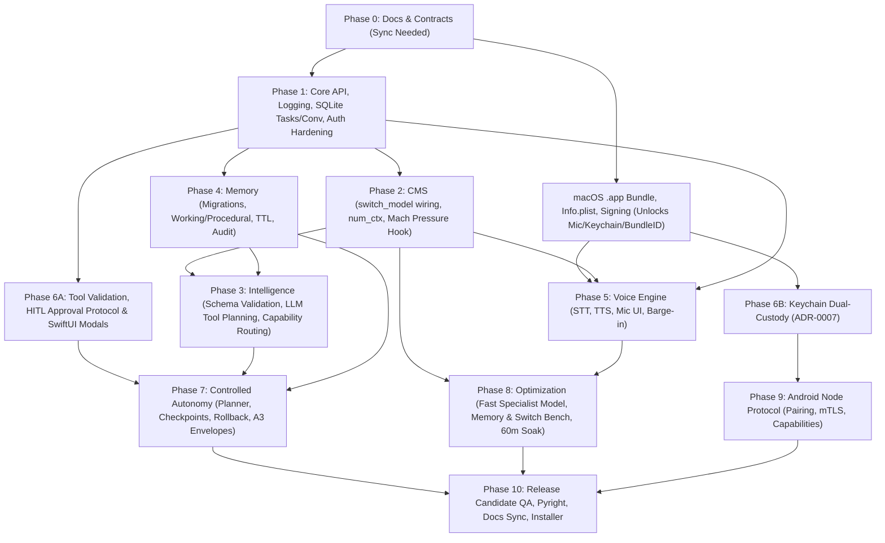

# Carbon 1.0.0 — Master Completion Audit

**Task ID:** `CARBON-1.0.0-MASTER-COMPLETION-AUDIT`  
**Audit Mode:** Strictly READ-ONLY repository inspection (no source, test, config, or existing-doc edits; no builds, installs, service starts/stops, or Git operations)  
**Branch / HEAD:** `backup/carbon-tested-phase1-2026-10-29` (`0c7d1d17c55c836715438c7d0c00887cf9aaf19c`, protected October 29 backup untouched)  
**Benchmark Specs:** [PRD.md](../product/PRD.md), [overview.md](../architecture/overview.md), [system-design.md](../architecture/system-design.md), [component-contracts.md](../architecture/component-contracts.md), [data-flow.md](../architecture/data-flow.md), `docs/architecture/adr/0001`–`0007`, and `docs/security/*`.

---

## 1. Executive Summary

Carbon currently has a **working, well-tested local chat & desktop process-lifecycle MVP** (FastAPI loopback server + Ollama `qwen3.5:9b` streaming + SQLite FTS5 semantic/episodic memory + heuristic reasoning depth + native macOS SwiftUI client with single-instance lock, process supervision, startup state machine, and 5-phase shutdown), **not** a complete Carbon 1.0.0 release candidate.

Across the original PRD roadmap (**Phase 0** foundation + **Phases 1–10** implementation):
- **Strong / Operational Core:** Local HTTP/WebSocket chat pipeline (`127.0.0.1:8765`), bearer token bootstrap (`0600`), token rotation, origin enforcement, Ollama single-model chat streaming (`qwen3.5:9b`), SQLite WAL + FTS5 semantic/episodic memory, and macOS app process supervision/shutdown (Stage 1.11 Increments 2A–2E + F1/G1 fixes).
- **Partially Implemented / Architectural Gaps:** Multi-model CMS runtime switching & live Mach memory pressure enforcement, Intelligence schema-validated planning/output validation, Working & Procedural memory tiers, Governance HITL approval flow & tool execution wiring, and latency/stability verification against PRD P95 targets.
- **Unimplemented / Skeleton:** Voice Engine (`src/carbon/voice/` empty), Controlled Multi-Step Autonomy (Phase 7), Android node pairing/encryption/capability negotiation (`DeviceManager` is a host-status stub), macOS Keychain secret storage (`ADR-0007`), and `Carbon.app` bundle packaging/release tooling (Phase 10).
- **Documentation Drift Found:** Several earlier security/architecture audit documents claim mechanisms not present in the actual code (`secrets.compare_digest`, atomic temp-file token rotation, `/api/v1/tools/{tool_name}/execute`, SQLite `tasks`/`conversations`/`model_registry`/`schema_migrations` tables, audit-log cryptographic chaining, and host battery/thermal/disk telemetry).

**Genuine 1.0.0 Release Verdict:** **NOT READY FOR 1.0.0 RELEASE.** Reaching an honest Carbon 1.0.0 Release Candidate requires closing tool/approval execution, real CMS pressure & switching safety, Voice (or explicit scope ADR), Controlled Autonomy bounds (or explicit scope ADR), Keychain custody, `.app` packaging, security/schema doc alignment, and a 60-minute stability pass.

---

## 2. Phase-by-Phase Implementation Status (Original PRD Numbering)

| Phase | Roadmap Title | Classification | Concise Assessment |
| :---: | :--- | :--- | :--- |
| **Phase 0** | Product and Architecture Foundation | **IMPLEMENTED AND VERIFIED** | PRD, architecture specs, data-flow, 7 ADRs, threat model, permission matrix, and benchmark methodology exist. Minor drift (`>=` deps vs pinned versions; stale claims in security/schema docs). |
| **Phase 1** | Carbon Core (+ macOS Desktop Shell) | **PARTIALLY IMPLEMENTED** | FastAPI loopback server, WS streaming, task tracking, structured logging, and SwiftUI lifecycle (2A–2E) work cleanly. Missing SQLite `tasks`/`conversations` persistence, `secrets.compare_digest` & atomic token swap, UI settings/approval/memory panels, and `.app` packaging. |
| **Phase 2** | Model Control Plane (CMS) | **PARTIALLY IMPLEMENTED** | Exclusive `_inference_lock` lease, `switch_model` Fair RWLock logic, and Ollama streaming/load/unload work cleanly in isolation. Missing `switch_model` wiring in `CarbonCore`, live Mach memory pressure hooks (`num_ctx` never passed), `model_registry` SQLite persistence, and real multi-model/specialist weights. |
| **Phase 3** | Intelligence Engine | **PARTIALLY IMPLEMENTED** | Deterministic regex/heuristic `classify_intent` routes Instant/Standard/Deep & Memory/Open-app intents well. Missing semantic/LLM fallback, structured task planning, tool capability extraction, and `validate_output` enforcement (method exists unused and ignores `expected_schema`). |
| **Phase 4** | Persistent Memory Engine | **PARTIALLY IMPLEMENTED** | SQLite WAL + FTS5 + in-place semantic updates + episodic history + user-directed `forget`/`forget_by_query` work well. `WORKING` and `PROCEDURAL` tiers are unused; `expires_at` decay/pruning, `schema_migrations`, embedding search, `MEMORY_FORGOTTEN` audit events, and UI controls are absent. |
| **Phase 5** | Voice Engine | **NOT IMPLEMENTED** | `src/carbon/voice/` and `benchmarks/voice/` are completely empty (`0` files). `protocols.py` omits `ISpeechToTextEngine`/`ITextToSpeechEngine`. Zero Whisper.cpp, Kokoro, mic capture, TTS playback, or barge-in code exists. |
| **Phase 6** | Governance and Controlled System Access | **PARTIALLY IMPLEMENTED** | `P0–P4`/`A0–A3` policy table (`GovernanceEngine`), JSONL audit file, and 3 built-in tools (`SystemInfoTool`, `ListApplicationsTool`, `OpenApplicationTool`) exist. **Missing:** HITL approval wait/resume flow & macOS confirmation UI, LLM tool-call wiring, runtime JSON-schema validation, audit log redaction/hashing, Keychain secret custody, and built-in tool unit tests. |
| **Phase 7** | Controlled Autonomy | **NOT IMPLEMENTED** | Zero multi-step task planner, execution loop, SQLite checkpointing/rollback, or bounded `A3` policy envelopes/step limits exist (only an `AutonomyLevel.A3` branch in `authorize_action`). |
| **Phase 8** | Performance Optimization | **PARTIALLY IMPLEMENTED** | Stage 1.10 prompt optimization cut `STANDARD` Java coding median from `42.35s` to `23.33s`, `INSTANT` runs at `0.47s`, throughput meets `15–22 tok/s`. Missing non-reasoning fast specialist model (`P95 <= 4s` standard UI TTFT remains unmet), empty `tests/performance/`, empty `benchmarks/orchestration/`, and 60-minute stability soak test. |
| **Phase 9** | Android Preparation | **SKELETON / PLACEHOLDER** | `DeviceManager` implements only `sysctl` RAM/OS host telemetry and an empty `self._connected_nodes` list. Zero pairing, auth, encryption, mTLS, or capability negotiation exists. |
| **Phase 10** | Release Preparation | **PARTIALLY IMPLEMENTED** | Stage 1.11 desktop lifecycle (`2A–2E`) and 85 Python + 81 Swift tests pass. Missing `.app` bundle/icon/codesigning/installer, Keychain migration, Pyright verification, 60-min stability run, and release runbooks matching actual behavior. |

---

## 3. Detailed Subsystem-by-Subsystem Audit

### Phase 0 — Product and Architecture Foundation (`IMPLEMENTED AND VERIFIED`)
1. **Original requirements ([PRD.md §9](../product/PRD.md#L594-L601)):** Review PRD, validate hardware feasibility, author architecture, interfaces, security/privacy policies, performance methodology, and ADRs (`0001`–`0007`).
2. **Relevant files:** `docs/product/PRD.md`, `docs/architecture/{overview,system-design,component-contracts,data-flow,database-schema,phase-0-validation-report,outstanding-risk-register,keychain-implementation-status,cms-lifecycle-and-state-machine}.md`, `docs/architecture/adr/0001`–`0007`, `docs/security/*`, `docs/benchmarks/methodology.md`, `pyproject.toml`, `.env.example`, `scripts/diagnostics.sh`.
3. **Implemented:** Full modular-monolith architecture specs, STRIDE threat model, P0–P4 / A0–A3 matrix, ADRs 0001–0007, hardware validation on Apple Silicon M5 16 GB (`results_100_runs.json`, `results_e2e_clean.json`, `hardware_verification_results.json`).
4. **Partially implemented:** Spec-to-code alignment (`api-security-code-review.md`, `database-schema.md`, `threat-model.md`, and `component-contracts.md` diverge from current Python modules).
5. **Missing:** Pinned Python dependency lockfile (`pyproject.toml` uses `>=` bounds rather than pinned versions required by `PRD §6.11`).
6. **Automated tests:** Indirectly checked by `tests/unit/test_settings.py` (2 tests verifying loopback defaults and `0.0.0.0`/LAN rejection).
7. **Runtime/manual verification:** `scripts/diagnostics.sh` checks OS/arch, RAM, Python, Ollama, `qwen3.5:9b`, Swift, `data/` permissions.
8. **Security & reliability risks:** Stale security review docs (`api-security-code-review.md`) overstate implemented hardening (`secrets.compare_digest`, atomic token swap), creating false confidence.
9. **Dependencies:** Foundation for Phases 1–10.
10. **Recommended sequence:** Synchronize docs/ADRs and pin dependencies after implementation stabilization (Phase 10).

---

### Phase 1 — Carbon Core, Local API, and Native macOS Client (`PARTIALLY IMPLEMENTED`)
1. **Original requirements ([PRD.md §4 FR-001, §5, §6, §9](../product/PRD.md#L125-L135)):** Modular monolith backend, clean startup/shutdown, task state machine & persistence, authenticated loopback FastAPI/WS API, native SwiftUI macOS desktop app, structured sanitized logging.
2. **Source files & classes:**
   - Backend: `CarbonCore` & `TaskRecord` ([orchestrator.py](../../src/carbon/core/orchestrator.py)), FastAPI app + `/ws/chat` + `/api/v1/system/shutdown` ([main.py](../../src/carbon/main.py)), `Settings` ([settings.py](../../src/carbon/config/settings.py)), `TokenSanitizingFilter` ([logging.py](../../src/carbon/core/logging.py)).
   - macOS Client: `CarbonApp`, `AppDelegate` ([CarbonApp.swift](../../apps/macos/Carbon/Sources/CarbonApp.swift)), `CarbonClient` ([CarbonClient.swift](../../apps/macos/Carbon/Sources/CarbonClient.swift)), `ContentView`, `MessageBubbleView` ([ContentView.swift](../../apps/macos/Carbon/Sources/ContentView.swift)), `MarkdownView`, `MarkdownParser`, `MathFormatter` ([MarkdownRenderer.swift](../../apps/macos/Carbon/Sources/MarkdownRenderer.swift)), `ProcessSupervisor` ([ProcessSupervisor.swift](../../apps/macos/Carbon/Sources/ProcessSupervisor.swift)), `SingleInstanceLock` ([SingleInstanceLock.swift](../../apps/macos/Carbon/Sources/SingleInstanceLock.swift)).
3. **Implemented:**
   - Loopback middleware rejecting non-loopback hosts & non-loopback `Origin` (including `Origin: null`), bearer REST auth (`verify_local_auth`), WS handshake/in-socket auth (`3.0s` timeout, query-string rejected, max `5` concurrent WS), graceful HTTP `/api/v1/system/shutdown` (`server.should_exit = True`).
   - Task creation, WebSocket streaming (`task_created`, `state_change`, `intent_classified`, `thinking`, `token`, `completed`, `cancelled`, `failed`), user cancellation (`cancel_task` + WS disconnect cleanup).
   - Native SwiftUI chat window, Markdown/Math streaming renderer, reasoning-depth segmented picker (`Auto`/`Instant`/`Standard`/`Deep`), single-instance `flock`, `ProcessSupervisor` startup state machine, PipeDrainer, and 5-phase shutdown + 8s watchdog (with D1, D2, F1, G1 fixes).
4. **Partially implemented:**
   - Token auth/rotation: `main.py:168, 366, 384` uses `!=`/`==` instead of `secrets.compare_digest`; `rotate_token` (`main.py:200`) overwrites `.carbon_token` directly instead of atomic temp-file swap.
   - Truncation surfacing: Backend sets `task.truncated` and streams a Markdown warning banner (`orchestrator.py:571-585`), but `CarbonClient.swift` ignores `json["task"]["truncated"]` and `ChatDisplayMessage` has no `isTruncated` property.
   - Single-instance UI focus (`Test E`): Works via PID activation API, but unbundled `.build/debug/Carbon` lacks `CFBundleIdentifier` so `frontmost` focus remained on Finder in automated verification.
5. **Missing:**
   - Persistent `tasks` and `conversations` SQLite tables (`self._tasks` in `orchestrator.py:140` is in-memory only and vanishes on restart; `database-schema.md` specifies both).
   - macOS Keychain secret storage (`ADR-0007`; currently POSIX `0600` file `data/.carbon_token`).
   - UI Settings view (autonomy tier, model status, memory controls), UI HITL permission modal/cards, UI Voice controls, and `.app` bundle/installer.
   - Backend cancellation hook immediately aborting underlying Ollama `httpx` HTTP stream on mid-chunk wait rather than only checking `task.cancel_event.is_set()` between yielded chunks (`orchestrator.py:530`).
6. **Automated tests & what they verify:**
   - `tests/unit/test_orchestrator.py` (2 tests): Task creation, `cancel_task`, `get_system_health`.
   - `tests/integration/test_api_endpoints.py` (9 tests): Root, health, task REST submission, authenticated/loopback/503/idempotent `/api/v1/system/shutdown`, lifespan `core.shutdown()`.
   - `tests/security/test_api_security.py` (8 tests): 401 checks, CORS/Origin (`null` rejected), token rotation `0600`, query-string WS rejection, log token masking.
   - `tests/test_desktop_connection_reliability.py` (11 tests): WS auth flows, reconnect, disconnect task cleanup.
   - Swift suites (`8` lock, `35` supervisor, `19` startup, `19` shutdown, `test_markdown`): Lock, process supervision, startup/retry/F1/G1, 5-phase shutdown/watchdog/D1/D2, Markdown/math/stop-button.
7. **Runtime/manual verification:** Increment 2E live runs verified `.build/debug/Carbon` startup, ownership, WS auth, mid-inference shutdown, 3 quit paths (`Quit Carbon`, `Dock -> Quit`, `File -> Close`), and recovery.
8. **Security & reliability risks:**
   - Non-constant-time token compare (`!=`) & non-atomic `rotate_token` write (`main.py:168, 200`).
   - POSIX `0600` token readable by any UID-501 user process (`RISK-002`).
   - `data/audit.log` bypasses `TokenSanitizingFilter`.
   - Active WS connections stay valid after token rotation until closed (`RISK-005`).
9. **Dependencies:** Foundations for CMS, Intelligence, Memory, Governance, Voice, Devices, and Release.
10. **Recommended sequence:** Fix `secrets.compare_digest` + atomic token rotation -> persist `tasks`/`conversations` in SQLite -> add Keychain (`ADR-0007`) & UI approval/settings panels -> package `.app`.

---

### Phase 2 — Model Control Plane (CMS) (`PARTIALLY IMPLEMENTED`)
1. **Original requirements ([PRD.md FR-003](../product/PRD.md#L157-L181), [cms-lifecycle-and-state-machine.md](../architecture/cms-lifecycle-and-state-machine.md), ADR-0002, ADR-0003, ADR-0006):** Sole model authority, model registry & capability metadata, health probes, automatic selection, Fair RWLock switching with unload/rollback, single active chat LLM invariant, dynamic memory pressure governance, specialist workload isolation.
2. **Source files & classes:** `CarbonModelSupervisor` ([cms.py](../../src/carbon/model_control/cms.py)), `OllamaProvider` ([ollama_provider.py](../../src/carbon/model_control/ollama_provider.py)), `ModelMetadata`, `ModelSwitchRequest`, `ModelCapability` ([models.py](../../src/carbon/interfaces/models.py)).
3. **Implemented:**
   - Ollama `/api/tags`, `/api/ps` runtime context inspection, `/api/generate` streaming (`think`, `options`, `done_reason`), `/api/chat` streaming helper (unused), `load_model`/`unload_model` (`keep_alive: 0`).
   - Exclusive `_inference_lock` lease (`acquire_inference_lease`/`release_inference_lease`), `_switch_pending` gate & `_drain_event`, 3-attempt unload abort guard, fallback rollback to `default_model_id`, and `handle_memory_pressure(1|2|4)` deferred critical unload logic.
4. **Partially implemented:**
   - Model switching & selection decoupling: `CarbonCore.execute_task_stream` (`orchestrator.py:427-435`) calls `select_model_for_task(...)` and then `acquire_inference_lease(...)` **without calling `switch_model(...)`** when the selected model differs from `_active_model`.
   - Dynamic memory pressure (`ADR-0006` / `RISK-004`): `handle_memory_pressure` is an isolated method never triggered by OS telemetry. Moreover, `cms.max_context_tokens` (`32768`/`8192`/`4096`) is **never forwarded as `num_ctx`** in `orchestrator.py` inference payloads, and Level 4's "prohibit deep reasoning" is only a log/string in `action_summary`, not enforced in `CarbonCore`/`IntelligenceEngine`.
   - Lease timeouts: `acquire_inference_lease` only bounds *waiting* for the lock (`60s`), while inference generation uses `inference_timeout_seconds = 300.0` rather than a 60s active lease watchdog.
5. **Missing:**
   - Native Mach kernel pressure hook (`DispatchSourceMemoryPressure` / `kern.memorystatus_vm_pressure_level`) and backend endpoint (`POST /api/v1/system/memory-pressure`).
   - Persistent `model_registry` SQLite table (`database-schema.md:98-112`).
   - Any non-Ollama provider, any second active LLM or fast non-reasoning specialist model (`1.5B–3B`), and real runtime model-switch testing against Ollama.
   - `IEmbeddingEngine`, STT/TTS specialist resource coordinators, and priority queuing (`asyncio.PriorityQueue` specified in `system-design.md:56` is absent).
6. **Automated tests & what they verify:**
   - `tests/unit/test_cms.py` (4 tests): Uses `MockProvider` to test init, capability match, lock state, and mocked switch.
   - `tests/unit/test_memory_pressure_and_switching.py` (8 tests): Uses mocks to verify Level 1/2/4 fields, `_switch_pending` lease drain, concurrent lease `TimeoutError`, unload failure abort, load failure rollback, and deferred Level 4 unload.
   - `tests/integration/test_e2e_inference.py` (1 test): Live inference with `qwen3.5:9b` (skipped when Ollama is stopped).
7. **Runtime/manual verification:** `qwen3.5:9b` verified live via Phase 0/Stage 1.10 benchmarks and Increment 2E; live multi-model switching has never been verified against Ollama.
8. **Security & reliability risks:**
   - If a second model is ever registered and selected by `select_model_for_task`, `CarbonCore` can issue `/api/generate` on the wrong/unloaded model without unloading `_active_model`, violating ADR-0003 unified-memory protection.
   - `RISK-003` (external processes calling `:11434` directly bypassing CMS).
   - No real OOM protection under macOS Level 4 memory pressure without OS listener + `num_ctx` enforcement.
9. **Dependencies:** Requires Core/SwiftUI OS pressure telemetry; needed by Intelligence, Voice, Embeddings, and Phase 8 Optimization.
10. **Recommended sequence:** Wire `switch_model` + lease-model match check in `CarbonCore` -> pass `cms.max_context_tokens` as `num_ctx` & enforce Level 4 deep-block -> add Swift `DispatchSourceMemoryPressure` -> `/api/v1/system/memory-pressure` -> test multi-model switching on live Ollama.

---

### Phase 3 — Intelligence Engine (`PARTIALLY IMPLEMENTED`)
1. **Original requirements ([PRD.md FR-002](../product/PRD.md#L136-L156), [system-design.md §2.3](../architecture/system-design.md#L77-L93)):** Intent understanding, complexity estimation, decoupled Instant/Standard/Deep routing, structured task preparation/planning, LLM output validation against schemas.
2. **Source files & classes:** `IntelligenceEngine` ([engine.py](../../src/carbon/intelligence/engine.py)), `TaskIntent` ([models.py](../../src/carbon/interfaces/models.py#L90-L97)), prompt construction in `CarbonCore.execute_task_stream` ([orchestrator.py:445-518](../../src/carbon/core/orchestrator.py#L445-L518)).
3. **Implemented:** Fast deterministic regex hierarchy (`COMPLEX_TASK` -> `MEMORY_STORE` -> `MEMORY_FORGET` -> `MEMORY_QUERY` -> `SYSTEM_COMMAND`/`CONVERSATIONAL` -> arithmetic -> `GENERAL_QUERY` standard indicators -> simple factual lookups -> concise clause -> `GENERAL_QUERY` default), coding vs explanatory system prompt specialization (`STANDARD`), JSON fence extraction in `validate_output`.
4. **Partially implemented:**
   - `validate_output(raw_output, expected_schema)` (`engine.py:217-232`) only parses JSON (`json.loads`); it completely ignores `expected_schema` and is **never called** by `CarbonCore` or any other module.
   - `SYSTEM_COMMAND` intent detection only catches `^open\s+[a-zA-Z0-9\s]+$` (`engine.py:40`), ignoring `system_info`, `list_applications`, or multi-word app names containing hyphens/dots.
5. **Missing:**
   - Any LLM/classifier semantic intent fallback beyond regexes.
   - Multi-step task planner & structured tool-call prompt generation.
   - Model-capability selection intelligence (`required_capabilities` never requests `TOOLS` or `VISION`, preventing CMS from routing tool/vision tasks cleanly).
   - Output validation enforcement against schemas / malformed tool-call rejection (`component-contracts.md:179`).
6. **Automated tests & what they verify:** `test_routing_reliability.py` (10 tests), `test_inference_optimization.py` (7 tests), `test_generation_optimization.py` (3 tests), `test_reasoning_and_ui_rendering.py` (4 tests). Verify regex routing rules, prompt construction, `think`/`options` kwargs, and truncation behavior—all with mocked Ollama responses. `validate_output` has zero test coverage.
7. **Runtime/manual verification:** Benchmarked in Stage 1.9/1.10 (`stage1_10-generation-benchmark-results.json`).
8. **Security & reliability risks:** Unvalidated LLM output; unused `validate_output` gives false assurance of output sanitization against malformed actions or prompt injection.
9. **Dependencies:** Required by Core orchestration, CMS capability routing, Governance tool-call parsing, and Phase 7 Autonomy.
10. **Recommended sequence:** Implement JSON Schema validation in `validate_output` -> wire LLM structured tool-call generation & validation in `CarbonCore` -> add capability detection (`TOOLS`/`VISION`) -> plan multi-step task decomposition (Phase 7).

---

### Phase 4 — Persistent Memory Engine (`PARTIALLY IMPLEMENTED`)
1. **Original requirements ([PRD.md FR-004](../product/PRD.md#L182-L208), [database-schema.md](../architecture/database-schema.md)):** Four memory categories (Working, Episodic, Semantic, Procedural), SQLite persistence + migrations, add/retrieve/search/update/forget, source/timestamp tracking, TTL decay/pruning, access controls, pluggable embedding/semantic retrieval, avoid storing every conversation automatically.
2. **Source files & classes:** `SQLiteMemoryEngine` ([sqlite_memory.py](../../src/carbon/memory/sqlite_memory.py)), `_extract_memory_fact` & memory dispatch ([orchestrator.py:83-111, 309-424, 591-600](../../src/carbon/core/orchestrator.py#L309-L424)).
3. **Implemented:** SQLite WAL + foreign keys + `memory_records` + FTS5 `memory_fts` with insert/delete/update triggers; in-place semantic updates; BM25 FTS search with LIKE fallback & UK/US spelling normalization; explicit `MEMORY_STORE`/`MEMORY_QUERY`/`MEMORY_FORGET` flows; per-conversation episodic turn retrieval (`limit=3`).
4. **Partially implemented:**
   - Storage tier coverage: Only `SEMANTIC` (explicit save) and `EPISODIC` (every completed chat interaction) are used. Notably, `orchestrator.py:591-600` automatically writes an `EPISODIC` row to SQLite for **every** completed response with `expires_at = None`, contradicting [PRD.md:207](../product/PRD.md#L207) and [privacy.md:15-17](../security/privacy.md#L15-L17) ("must not automatically store every conversation as permanent memory"). `WORKING` and `PROCEDURAL` tiers are never created, queried, or flushed.
   - Schema & pragmas: `sqlite_memory.py` omits `busy_timeout = 5000`, `temp_store = MEMORY`, `cache_size = -64000`, `idx_memory_updated_at`, `schema_migrations`, `tasks`, `conversations`, and `model_registry` specified in `database-schema.md`.
   - Forgetting protocol: Deletes matching records cleanly, **but** omits `MEMORY_FORGOTTEN` audit logging (`database-schema.md:158`), and `forget_by_query` is capped at `limit=100` via BM25 FTS (`sqlite_memory.py:304`), which can silently leave >100 matching records or stopword-only queries un-deleted.
5. **Missing:**
   - `WorkingMemory` buffer/lifecycle management and `ProceduralMemory` workflow templates.
   - TTL `expires_at` pruning and relevance decay.
   - Embedding engine (`IEmbeddingEngine`) & vector/hybrid retrieval.
   - Memory access controls and native macOS UI for browsing/editing/deleting saved memories.
6. **Automated tests & what they verify:** `test_memory.py` (3 tests), `test_memory_pipeline.py` (10 tests): Real SQLite store/retrieve/search/forget, persistence across restart, US/UK normalization, rowid FTS integrity, negative-memory prompt rule, conversation history isolation. None test `WORKING`, `PROCEDURAL`, `expires_at`, migrations, or >100-record forgetting.
7. **Runtime/manual verification:** Verified in `benchmark` / live backend (`data/carbon.db` present); `benchmarks/memory/hardware_verification_results.json` measured CMS memory rather than SQLite scale benchmarks.
8. **Security & reliability risks:** Unbounded DB growth without TTL/pruning; missing `busy_timeout = 5000` risks `database is locked` under concurrent tasks; missing `MEMORY_FORGOTTEN` audit trail.
9. **Dependencies:** Needed by Intelligence context injection, Phase 7 Autonomy (procedural workflows / checkpoints), and macOS UI.
10. **Recommended sequence:** Add `schema_migrations` + remaining pragmas + `tasks`/`conversations` tables -> wire `MEMORY_FORGOTTEN` audit & TTL pruning -> add `WORKING` & `PROCEDURAL` support -> evaluate local embeddings (optional) & UI inspector.

---

### Phase 5 — Voice Engine (`NOT IMPLEMENTED`)
1. **Original requirements ([PRD.md FR-005, §6.8, §9](../product/PRD.md#L209-L228)):** Independent Voice subsystem supporting mic input, local STT (benchmark Whisper.cpp), local TTS (benchmark Kokoro), interruptible speech output, VAD, barge-in cancellation, isolated `<= 500 MB` ANE/CPU memory budget.
2. **Relevant files:** `src/carbon/voice/` (**empty directory**), `benchmarks/voice/` (**empty directory**), `component-contracts.md:92-114` (`ISpeechToTextEngine`, `ITextToSpeechEngine` documented only in Markdown—**not even present in `src/carbon/interfaces/protocols.py`**!).
3. **Implemented:** **None.**
4. **Partially implemented:** **None.**
5. **Missing:** Contracts in `protocols.py`, Swift mic capture (`AVAudioEngine`) & macOS privacy permission strings (`NSMicrophoneUsageDescription` in missing `Info.plist`), STT engine benchmarking/integration, TTS engine benchmarking/integration, audio streaming IPC over WebSocket/REST, VAD & barge-in interruption wiring to `Core.cancel_task`, and voice UI controls.
6. **Automated tests:** **None** (`0` unit, integration, or performance tests).
7. **Runtime/manual verification:** **None.**
8. **Security & reliability risks:** Microphone TCC permission requires proper bundle identity (`Carbon.app` + `Info.plist` + signing); speech models must honor `ADR-0006` `<= 500 MB` budget isolation so `qwen3.5:9b` does not swap on 16 GB RAM.
9. **Dependencies:** Depends on `.app` bundle (`Info.plist`), CMS specialist memory budget enforcement, Core cancellation path.
10. **Recommended sequence:** Add `ISpeechToTextEngine`/`ITextToSpeechEngine` to `protocols.py` -> benchmark Whisper.cpp & Kokoro on M5 -> implement audio pipeline & barge-in -> integrate macOS mic/audio UI after `.app` bundle exists.

---

### Phase 6 — Governance and Controlled System Access (`PARTIALLY IMPLEMENTED`)
1. **Original requirements ([PRD.md FR-006, FR-007](../product/PRD.md#L229-L270), [permission-matrix.md](../security/permission-matrix.md)):** `P0–P4` permission tiers, `A0–A3` autonomy tiers, conservative default (`A1`), interactive UI confirmation (cards for P1/P2, modal + double-confirm for P3/P4, 60s timeout), Pydantic-validated tool registry with sandboxing/timeouts/audit, approved macOS tools (detect apps, open apps, read explicitly approved files, system info, reversible operations).
2. **Source files & classes:** `GovernanceEngine` ([governance_engine.py](../../src/carbon/governance/governance_engine.py)), `BaseTool`, `ToolRegistry` ([base.py](../../src/carbon/tools/base.py)), `SystemInfoTool`, `ListApplicationsTool`, `OpenApplicationTool` ([builtin.py](../../src/carbon/tools/builtin.py)), `CarbonCore` fast-path ([orchestrator.py:259-306](../../src/carbon/core/orchestrator.py#L259-L306)).
3. **Implemented:**
   - `GovernanceEngine.authorize_action`: P4 always returns `False`; A0 always `False`; A1 only P0; A2 P0–P2; A3 P0–P3; logs `AUTHORIZATION_EVALUATED` to `data/audit.log` (`0600`).
   - `ToolRegistry` registers 3 tools (`system_info`, `list_applications`, `open_application`), generates LLM tool schemas (`get_schemas_for_llm`), wraps execution in `asyncio.wait_for`.
   - `OpenApplicationTool` uses explicit `APPROVED_APPS` allowlist and `asyncio.create_subprocess_exec` (no shell).
4. **Partially implemented:**
   - Fast-path tool dispatch: Under default `A1`, saying `"open Safari"` triggers `authorize_action(...)` -> returns `False` -> emits `{"event": "awaiting_approval"}` -> **immediately marks the task `COMPLETED` with a text refusal (`orchestrator.py:280-293`)** instead of pausing for user confirmation!
   - `ListApplicationsTool` (`builtin.py:87`) casts `limit` without enforcing positive bounds (`limit <= 0` or negative slicing works unexpectedly) or enforcing `additionalProperties: False`.
5. **Missing:**
   - **End-to-end HITL Approval Protocol:** No WS `action: "approve"` / `"deny"`, no REST `/approve`, no `60s` timeout auto-cancel (`permission-matrix.md:81`), and **zero** handling of `awaiting_approval` or confirmation UI in `CarbonClient.swift` / `ContentView.swift`.
   - **LLM-driven Tool Invocation:** `get_schemas_for_llm()` and `chat_stream(..., tools=...)` are never called; `system_info` and `list_applications` have no execution path from either chat or REST (`GET /api/v1/tools` exists, `POST /api/v1/tools/{id}/execute` does not).
   - **Runtime Input Schema Validation & Approved File Tool:** `ToolRegistry.execute_tool` never validates `arguments` against `parameters_schema` (`tool.definition`). Explicit approved-file-read tool (`FR-006`) is missing.
   - **Security Hardening:** Cryptographic hash-chaining on `audit.log`, `TokenSanitizingFilter` on audit entries, prompt-injection delimiter isolation on tool outputs, runtime Autonomy setting switcher, and Keychain integration (`ADR-0007`).
6. **Automated tests & what they verify:**
   - `tests/unit/test_governance.py` (5 tests): Tests `authorize_action` matrix and `record_audit_entry` file write.
   - **Missing tests:** `tests/` has **zero** unit or integration tests for `ToolRegistry.execute_tool`, tool timeouts, `SystemInfoTool`, `ListApplicationsTool`, `OpenApplicationTool` whitelist enforcement, approval-pause/resume flow, or prompt-injection resistance.
7. **Runtime/manual verification:** Only initialization audit entries (`CARBON_CORE_INITIALIZED`, `CARBON_CORE_SHUTDOWN`) appear in `data/audit.log` during recent runs.
8. **Security & reliability risks:**
   - Missing runtime JSON Schema argument validation allows malformed/unexpected arguments to reach tool handlers.
   - Unsanitized `record_audit_entry` could persist sensitive parameters if future tools handle tokens/paths.
   - `A1` users cannot actually approve P1/P2 actions without switching `CARBON_AUTONOMY_LEVEL` manually in `.env`/env, creating temptation to enable `A2`/`A3` without UI oversight.
9. **Dependencies:** Required before Phase 7 Autonomy can safely execute any multi-step action.
10. **Recommended sequence:** Enforce JSON schema validation in `ToolRegistry` -> implement real HITL approval pause/resume over WS + SwiftUI modal/card UI -> wire `system_info`/`list_applications`/approved file-read tools + comprehensive tool/security tests -> add Keychain + audit sanitization.

---

### Phase 7 — Controlled Autonomy (`NOT IMPLEMENTED`)
1. **Original requirements ([PRD.md §9](../product/PRD.md#L649-L655), [cms-lifecycle-and-state-machine.md §4.3](../architecture/cms-lifecycle-and-state-machine.md#L114-L118)):** Multi-step task planning, controlled multi-step execution loop, SQLite task checkpointing before tool calls, failure recovery/rollback, bounded `A3` execution limits & policy envelopes.
2. **Relevant files:** None dedicated (`AutonomyLevel.A3` enum branch in [governance_engine.py:67-74](../../src/carbon/governance/governance_engine.py#L67-L74) is the only trace).
3. **Implemented:** None (besides single-step `A3` permission lookup returning `True` for `P0–P3`).
4. **Partially implemented:** None.
5. **Missing:** Multi-step planner, max-step / max-duration / step-budget guardrails, policy envelope enforcement (allowed paths/apps/actions for `A3`), SQLite `tasks` checkpointing & crash recovery/rollback, and multi-step UI progress + per-step abort controls.
6. **Automated tests:** **None.** `test_governance.py:22` checks `A3` only to prove `P4` returns `False`.
7. **Runtime/manual verification:** **None.**
8. **Security & reliability risks:** Setting `CARBON_AUTONOMY_LEVEL=A3` today auto-approves all `P0–P3` operations with **zero** policy boundaries, step limits, or rollback mechanisms if multi-step tool dispatch were enabled.
9. **Dependencies:** Strictly blocked until Phases 3 (Planner/Output Validation), 4 (`tasks` & `PROCEDURAL` SQLite), and 6 (HITL Approvals & Validated Tool Execution) are complete.
10. **Recommended sequence:** Build only after Phases 3, 4, and 6 are tested end-to-end.

---

### Phase 8 — Performance Optimization (`PARTIALLY IMPLEMENTED`)
1. **Original requirements ([PRD.md §7, §9](../product/PRD.md#L495-L522), [methodology.md](../benchmarks/methodology.md)):** Latency optimization (Simple P95 `<= 2s`, Standard P95 `<= 4s`, cached memory P95 `<= 100ms`, orchestration `<= 50ms`), throughput `>= 15 tok/s`, memory & switching optimization, **60-minute stability test**, security review.
2. **Relevant files & artifacts:** `scripts/run_stage1_10_optimization_benchmark.py`, `scripts/experiment_penalty_and_prompt_ab.py`, `benchmarks/inference/{benchmark_100_runs.py,benchmark_e2e_pipeline.py,statistical_benchmark.py}`, `benchmarks/memory/hardware_memory_verification.py`, `docs/reports/stage1_10-generation-optimization.md`, `docs/benchmarks/end-to-end-latency-report.md`.
3. **Implemented & Verified:**
   - Orchestration overhead measured at `<= 1.0 ms` (beats `<= 50 ms` target).
   - Instant factual fast-path: `0.469s` median, `0.637s` P95 (meets `P95 <= 2s`).
   - Generation throughput: `15.07–22.09 tok/s` clean normal (meets `>= 15 tok/s`).
   - Stage 1.10 task-aware prompt specialization cut Standard Java coding median by 44.9% (`42.35s -> 23.33s`) and analytical median by 47.0% (`68.77s -> 36.47s`).
   - Hardware memory telemetry verified (`~5.82–6.55 GB` resident/disk footprint on 16 GB M5).
4. **Partially implemented:**
   - Standard/Complex UI TTFT & total latency: With `think=False` in `STANDARD`, total time is `6.2s–36.5s` median (`89.05s` P95 analytical); with `think=True` (`DEEP` / un-dispatched thinking), UI TTFT was measured at `59s–154s` (`end-to-end-latency-report.md`). Thus the original `PRD` **Standard P95 `<= 4s` first-token/response target is NOT met** for general standard/complex queries without a fast non-reasoning specialist model.
   - Model switching optimization: Simulated only; not benchmarked across two real Ollama models (`PRD` `<= 6.0s` cold switch unmeasured live).
5. **Missing:**
   - **60-minute continuous stability / soak test (`PRD §7`):** Zero 60-minute runs exist in `benchmarks/` or `docs/`.
   - Automated performance regression suite: `tests/performance/` and `benchmarks/orchestration/` are **empty (0 files)**.
   - SQLite memory micro-benchmarks (`P95 <= 100 ms` target at scale) — `benchmarks/memory/hardware_memory_verification.py` tested CMS/Ollama memory rather than SQLite query scale.
   - Fast non-reasoning specialist model integration for `< 1s` operational queries.
6. **Automated tests:** `test_generation_optimization.py` (3 tests verifying prompt specialization & truncation), `test_inference_optimization.py` (7 tests) — unit contract tests only, no live timing assertions in `tests/performance/`.
7. **Runtime/manual verification:** Stage 1.10 (`N=5` x 6 workloads = 30 runs) and Phase 0 (`N=100` runs) JSON benchmarks exist.
8. **Security & reliability risks:** Unverified memory/leak/FD behavior over a 60-minute multi-turn run; unmeasured multi-model swap pressure on 16 GB RAM.
9. **Dependencies:** Depends on Phase 2 CMS real multi-model support and Phase 5 Voice benchmarks.
10. **Recommended sequence:** Populate `tests/performance/` (SQLite + Core overhead + real Ollama switch benchmark) -> evaluate specialist small model in CMS -> execute 60-minute stability soak test prior to RC.

---

### Phase 9 — Android Node Preparation (`SKELETON / PLACEHOLDER`)
1. **Original requirements ([PRD.md FR-008, §9](../product/PRD.md#L271-L278)):** Device Engine local Mac layer + future-compatible connected Android node preparation (pairing protocol, authentication, encryption, device capability model, Samsung S23 FE planning). *(Note: Full Android app explicitly excluded from 1.0.0 per `PRD §3.2`.)*
2. **Source files & classes:** `DeviceManager` ([devices/manager.py](../../src/carbon/devices/manager.py)), `IDeviceEngine` ([protocols.py:134-137](../../src/carbon/interfaces/protocols.py#L134-L137)).
3. **Implemented:** `DeviceManager.get_host_status()` (`mac-local`, hostname, OS, version, arch, CPU count, `sysctl -n hw.memsize`, `"online"`) and `list_connected_nodes()` returning `[host] + self._connected_nodes`.
4. **Partially implemented:** Local Mac host metrics omit battery percentage, thermal throttling status (`pmset`), and APFS storage availability described in `system-design.md:144` / `phase-1-implementation-audit.md:38`.
5. **Missing:** Entire Android preparation protocol — node schema/capability models, pairing & cryptographic identity/auth handshake, transport encryption (mTLS/Noise), node registration/heartbeat/disconnect, and Android node architecture ADR/spec.
6. **Automated tests:** Only `test_system_health_telemetry` (`test_orchestrator.py:43-49`) checks `unified_memory_gb > 0`; zero tests call `list_connected_nodes()` or test remote device flows.
7. **Runtime/manual verification:** `GET /api/v1/system/status` / `GET /api/v1/health` exercised during integration & Stage 1.11 2E tests.
8. **Security & reliability risks:** Adding remote device endpoints later without a formally specified pairing, mutual-auth, and capability-boundary protocol risks breaking Carbon's loopback isolation invariant (`Rule 6`).
9. **Dependencies:** Builds on Governance (`P0–P4`) and Keychain/credential architecture.
10. **Recommended sequence:** Specify device protocol & capability contract ADR -> implement pairing/auth/capability schemas -> add Mac thermal/battery telemetry -> defer full Android client post-1.0.0.

---

### Phase 10 — Release Preparation (`PARTIALLY IMPLEMENTED`)
1. **Original requirements ([PRD.md §9, §10](../product/PRD.md#L670-L698)):** Full functional/security/performance testing, complete documentation matching implementation, installation & recovery procedures, standalone native Mac launch reliability, release candidate verification.
2. **Relevant files:** `apps/macos/Carbon/` (Sources + 5 Swift test suites), `tests/` (`86` Python tests), `scripts/diagnostics.sh`, `docs/development/{setup,testing,contributing}.md`, `docs/reports/stage1_11-increment-2A`–`2E*`.
3. **Implemented:**
   - Stage 1.11 desktop lifecycle foundation (`SingleInstanceLock`, `ProcessSupervisor`, startup state machine, 5-phase graceful shutdown + watchdog + F1/G1 fixes) tested end-to-end against real Ollama & Python backend.
   - Automated suites verified: `85 passed, 1 skipped` (`pytest`), `8/8` lock, `35/35` supervisor, `19/19` startup, `19/19` shutdown, `test_markdown`, `swift build`, `ruff`, `git diff --check`.
4. **Missing:**
   - **Standalone `Carbon.app` bundle:** No `Info.plist`, `AppIcon.icns`, release packaging/codesigning script, or `/Applications/Carbon.app` install/uninstall/recovery procedure.
   - **Security/Architecture release blockers:** macOS Keychain migration (`ADR-0007`), HITL confirmation UI, Voice/Autonomy completion (or explicit ADR-documented deferral from 1.0.0), SQLite migrations & schema completion.
   - **QA Gaps:** `pyright` type-checking has not been verified in recent release reports; `tests/integration/test_e2e_inference.py` skips silently when Ollama is stopped; `tests/performance/` is empty; `docs/development/setup.md` and security/schema docs lag behind actual code (still instruct `brew services start ollama` + manual testing, omit Stage 1.11 Carbon.app workflow, and misstate `main.py` implementation details).
5. **Dependencies:** Final gate after Phases 1–9 are resolved or formally scoped.

---

## 4. Explicit List of Features That Must NOT Be Claimed Complete

Do **not** report or market any of the following as complete in Carbon 1.0.0:
1. **Voice Engine (STT, TTS, VAD, audio capture, speech interruption)** — `src/carbon/voice/` is empty (`0` code).
2. **Controlled Autonomy (Phase 7: multi-step planning, A3 policy envelopes, step limits, SQLite task checkpointing/rollback)** — unimplemented beyond an A3 enum branch in `GovernanceEngine`.
3. **Human-in-the-Loop Tool Confirmation UI & Approval Resume Workflow** — `awaiting_approval` immediately finishes the task; no SwiftUI dialog/cards or backend resume handler exists.
4. **LLM-Driven Tool Calling & Schema Validation** — `chat_stream(..., tools=...)` and `validate_output` are unused; `system_info` and `list_applications` cannot be invoked via chat or REST; runtime argument JSON Schema validation is missing; approved-file-read tool is missing.
5. **Dynamic Mach Kernel Memory Pressure Monitoring & Context Enforcement** — no OS pressure listener, no HTTP endpoint, and `max_context_tokens` is never sent as `num_ctx` to Ollama.
6. **Live Multi-Model Switching & Specialist Model Routing** — `CarbonCore` never calls `cms.switch_model`; only `qwen3.5:9b` runs in production; no small non-reasoning specialist model exists.
7. **Working Memory & Procedural Memory Tiers / TTL Decay / Migrations** — only Semantic and Episodic rows exist in SQLite; `tasks`, `conversations`, `model_registry`, and `schema_migrations` tables do not exist.
8. **macOS Keychain Secret Custody (`ADR-0007`)** — `data/.carbon_token` remains a plaintext POSIX `0600` file.
9. **Android Node Preparation Protocol** — no pairing, auth, encryption, or capability negotiation exists beyond an empty `self._connected_nodes` list.
10. **Standalone `Carbon.app` Packaging, Signing & Installation** — no `Info.plist`, icon, `.app` bundle, or `/Applications` install workflow exists.
11. **60-Minute Stability Verification & Standard P95 <= 4s Latency Compliance** — 60-minute soak test has never been implemented or run; Standard/Deep latencies still exceed `PRD §7` targets.
12. **Audit Log Cryptographic Chaining & Sanitization / Constant-Time Token Auth** — `audit.log` uses plain unhashed JSONL without `TokenSanitizingFilter`; `main.py` uses `!=`/`==` and non-atomic `open(..., "w")` rather than `secrets.compare_digest` and temp-file atomic replace.

---

## 5. Security, Architecture Risks, and Doc-vs-Code Drift

| Risk / Drift ID | Severity | Evidence | Impact |
| :--- | :---: | :--- | :--- |
| **SEC-DRIFT-1** | **High** | [api-security-code-review.md:40, 119](../security/api-security-code-review.md#L40) claims `secrets.compare_digest`, atomic `temp_path.replace`, and `/api/v1/tools/{name}/execute`; [main.py:168, 200, 366, 384](../../src/carbon/main.py#L168-L202) uses `!=`/`==` and non-atomic `open(token_path, "w")` | Timing side-channel on token checks, brief torn-token race during rotation, and inaccurate security audit docs. |
| **SEC-KEYCHAIN-1** | **Medium** | [keychain-implementation-status.md](../architecture/keychain-implementation-status.md); `data/.carbon_token` | Any process running under the user's macOS UID can read the local API bearer token (`RISK-002`). |
| **GOV-BYPASS-1** | **High** | [orchestrator.py:259-293](../../src/carbon/core/orchestrator.py#L259-L293); [tools/base.py:64-100](../../src/carbon/tools/base.py#L64-L100); [governance_engine.py:67-74](../../src/carbon/governance/governance_engine.py#L67-L74) | No HITL UI workflow in default `A1`, no runtime JSON-schema validation of tool arguments, `audit.log` lacks `TokenSanitizingFilter`/hashing, and `A3` grants P0–P3 auto-execution with zero policy envelopes or step limits. |
| **CMS-OOM-1** | **High** | [cms.py:89-116, 232-293](../../src/carbon/model_control/cms.py#L89-L116); [orchestrator.py:427-518](../../src/carbon/core/orchestrator.py#L427-L518) | `CarbonCore` does not call `switch_model` if a non-active model is selected, does not pass `max_context_tokens` as `num_ctx`, and no OS memory-pressure signal ever calls `handle_memory_pressure`. |
| **SCHEMA-DRIFT-1** | **Medium** | [database-schema.md](../architecture/database-schema.md); [sqlite_memory.py:36-92](../../src/carbon/memory/sqlite_memory.py#L36-L92) | `tasks`, `conversations`, `model_registry`, `schema_migrations`, `busy_timeout=5000`, and `MEMORY_FORGOTTEN` audit logs are missing in code; active tasks vanish on restart. |
| **PRIV-RETENTION-1** | **Medium** | [privacy.md:15-17](../security/privacy.md#L15-L17); [orchestrator.py:591-600](../../src/carbon/core/orchestrator.py#L591-L600) | Every completed chat task is persisted permanently as `EPISODIC` with `expires_at = None`, conflicting with PRD FR-004 and Privacy Principle 2. |
| **BUNDLE-PORT-1** | **Medium** | [Package.swift](../../apps/macos/Carbon/Package.swift); [ProcessSupervisor.swift:495-503](../../apps/macos/Carbon/Sources/ProcessSupervisor.swift#L495-L503); [SingleInstanceLock.swift:118-135](../../apps/macos/Carbon/Sources/SingleInstanceLock.swift#L118-L135) | No `.app` bundle/signing/`Info.plist` yet; `resolveDefaultProjectRoot()` assumes `~/Carbon` when launched from Finder (`cwd == /`), and unbundled `CFBundleIdentifier == nil` weakens `activatePrimaryInstance` focus switching (`Test E`). |

### ADR Compliance Summary (`ADR-0001` – `ADR-0007`)

| ADR | Decision | Actual Code Status |
| :--- | :--- | :--- |
| **ADR-0001** | Modular Monolith (`carbon.*` + SwiftUI client) | **IMPLEMENTED AND VERIFIED** (Python modular monolith + SwiftUI client). |
| **ADR-0002** | CMS Sole Model Authority / LLM Worker Containment | **PARTIALLY IMPLEMENTED** (LLM lacks raw shell/model control, but `validate_output` & LLM tool loop are unwired and `CarbonCore` does not call `switch_model`). |
| **ADR-0003** | Single Active Chat LLM Concurrency | **PARTIALLY IMPLEMENTED** (`_inference_lock` enforces mutex for `qwen3.5:9b`; untested across multiple live models and `select_model_for_task` does not trigger `switch_model`). |
| **ADR-0004** | SQLite Structured Persistence + WAL + FTS5 | **PARTIALLY IMPLEMENTED** (`memory_records` + `memory_fts` + WAL work; `schema_migrations`, `tasks`, `conversations`, `model_registry`, and `WORKING`/`PROCEDURAL` tiers are absent). |
| **ADR-0005** | Loopback REST + WebSocket IPC (`127.0.0.1:8765`) | **PARTIALLY IMPLEMENTED** (Loopback REST & `/ws/chat` work cleanly; `/ws/events` & push approval events do not operate end-to-end). |
| **ADR-0006** | Dynamic Unified Memory & Mach Pressure Governance | **PARTIALLY IMPLEMENTED** (Logic exists in `cms.handle_memory_pressure`, but Mach pressure polling, `/api/v1/system/memory-pressure`, and `num_ctx` forwarding are not implemented). |
| **ADR-0007** | macOS Keychain Dual-Custody vs POSIX `0600` | **NOT IMPLEMENTED** (`KeychainHelper.swift` & `CARBON_ENV=production` disk elimination absent; `data/.carbon_token` remains POSIX `0600`). |

---

## 6. Items That Cannot Be Verified / Unverified Checks

Under the strictly read-only rules of this audit (no running services, installs, builds, or test mutations), the following items could **not** be independently verified or remain unverified in the repository:

1. **Pyright static type-checking (`[tool.pyright]` in `pyproject.toml`):** Not executed during Stage 1.11 or this audit; current type-check status across `src/` and `tests/` is **unverified**.
2. **Test execution in this audit turn:** Automated test counts cited (`85 passed, 1 skipped` in `pytest`; `8/8` lock, `35/35` supervisor, `19/19` startup, `19/19` shutdown, `test_markdown`, `swift build`, `ruff`, `git diff --check`) reflect direct execution immediately prior in `C-1.11-P2-2E-FIX` rather than re-running suites in this audit turn; live `test_e2e_inference.py` (`1` test) was skipped during that offline `pytest` run because Ollama was stopped.
3. **60-minute stability soak (`PRD §7`):** Cannot be verified because no 60-minute continuous stability harness or dataset exists anywhere in the repository.
4. **Live multi-model switching & memory-pressure reaction (`Phase 2 / ADR-0006`):** Cannot be verified at runtime because only one chat model (`qwen3.5:9b`) is wired and no Mach kernel pressure source exists.
5. **Voice, Controlled Autonomy, Android pairing, HITL confirmation modals, and `/Applications/Carbon.app` execution:** Cannot be runtime-verified because those implementations/bundles do not exist yet.
6. **Direct macOS Accessibility GUI button clicks (`Cancel`, `Retry`, titlebar close button):** Blocked by macOS TCC (`System Events` returned `0` windows for GUI apps during Increment 2E); banner rendering & button interactions were verified via compilation, Swift state-machine tests, `File -> Close`, `Quit Carbon`, and `Dock -> Quit`.

---

## 7. Dependency Map

---

## 8. Recommended Completion Order & Prioritized Master Implementation Roadmap

### Stage A — Security, Stability & Persistence Debt (Fix Existing Partial Work First)
1. **Harden Local API & Audit Pipeline (`main.py`, `governance_engine.py`):**
   - Replace `!=`/`==` token checks with `secrets.compare_digest`.
   - Restore atomic temp-file replacement in `POST /api/v1/auth/rotate-token` and push WebSocket token-rotation re-auth frame (`RISK-005`).
   - Apply `TokenSanitizingFilter` redaction and optional hash-chaining to `GovernanceEngine.record_audit_entry`; log `MEMORY_FORGOTTEN` events.
2. **Complete SQLite Schema & CMS Safety Wiring (`sqlite_memory.py`, `cms.py`, `orchestrator.py`):**
   - Add `schema_migrations`, `tasks`, `conversations`, `model_registry` tables and `busy_timeout = 5000` pragma; persist tasks across restarts.
   - Ensure `CarbonCore` triggers `cms.switch_model` whenever `select_model_for_task` differs from `_active_model`, passes `cms.max_context_tokens` as `num_ctx`, honors Level 4 `DEEP` blocking, and aborts upstream `httpx` stream promptly on cancellation.
   - Wire `DispatchSourceMemoryPressure` in Swift -> `/api/v1/system/memory-pressure` in FastAPI -> `cms.handle_memory_pressure`.
3. **Wire Tool Validation & Human-in-the-Loop Governance (`tools/base.py`, `orchestrator.py`, `CarbonClient.swift`, `ContentView.swift`):**
   - Enforce `parameters_schema` validation inside `ToolRegistry.execute_tool` and add tests for all built-in tools + safe approved-file-read tool.
   - Implement genuine `AWAITING_APPROVAL` pause/resume + 60s timeout in backend + SwiftUI approval cards (P1/P2) and double-confirm sheets (P3/P4).
   - Wire `IntelligenceEngine.validate_output` cleanly against expected schemas and enable LLM-requested approved tool execution under Governance control.

### Stage B — Native macOS Packaging & Keychain Security
4. **Produce Signed `Carbon.app` Bundle & Installer Script:**
   - Add `Info.plist`, `AppIcon.icns`, release packaging script installing to `/Applications/Carbon.app`, configurable project-root fallback beyond `~/Carbon`, and re-test `Test E` activation with real `CFBundleIdentifier`.
5. **Implement macOS Keychain Dual-Custody (`ADR-0007`):**
   - Add `KeychainHelper.swift`, inject token via environment/secure IPC when launching backend from `Carbon.app`, add UI `isTruncated` badge + Settings/Memory views.

### Stage C — Missing Product Pillars (Or Formal Scope ADRs)
6. **Phase 5 — Voice Engine:** Implement `ISpeechToTextEngine` & `ITextToSpeechEngine` in `protocols.py`, benchmark Whisper.cpp & Kokoro within `<= 500 MB` ANE/CPU budget, build macOS `AVAudioEngine` mic capture/playback & barge-in cancellation. *(If deferred past 1.0.0, publish a formal ADR updating PRD §3.1/§10 rather than leaving silent gaps.)*
7. **Phase 7 — Controlled Autonomy & Memory Tiers:** Implement `WORKING`/`PROCEDURAL` memory lifecycle, `expires_at` pruning, multi-step planner, SQLite task checkpoint/rollback, and strict `A3` policy envelopes + step/time caps. *(Or formally defer `A3` autonomous workflows via ADR.)*
8. **Phase 9 — Android Node Preparation:** Document and implement the authenticated/encrypted device pairing & capability-negotiation schema in `src/carbon/devices/` + add Mac battery/thermal/disk telemetry.

### Stage D — Optimization, Full QA & Release Candidate Gate
9. **Phase 8 — Specialist Model & Stability Benchmarks:** Evaluate a lightweight non-reasoning model for fast simple queries (`UI TTFT < 1s` / `P95 <= 4s`), populate `tests/performance/` & `benchmarks/orchestration/`, benchmark live CMS model switching, and execute the **60-minute continuous stability test**.
10. **Phase 10 — Release Verification & Documentation Sync:** Pin exact dependency versions (`pyproject.toml` / lockfile), run `pyright`, `ruff`, full offline + live-Ollama `pytest`, full Swift suites, re-verify `/Applications/Carbon.app` E2E lifecycle, and update all docs (`setup.md`, `api-security-code-review.md`, `database-schema.md`, `threat-model.md`) to match exact code behavior.

---

## 9. Final Recommendation for Reaching a Genuine Carbon 1.0.0 Release Candidate

Carbon's Phase 1/Stage 1.11 backend core, CMS concurrency model, SQLite FTS5 semantic memory, and native macOS process supervision/shutdown foundation are solid, clean, and well-tested. However, **PRD §10 ("Definition of Done") explicitly requires working Voice I/O, permission-controlled computer actions with confirmation UI, schema-validated tool security, persistent task recovery, measured compliance across performance/stability targets, and verified installation/recovery**.

**Recommended immediate decision gate for project owner:**
1. Approve **Stage A + Stage B** first (fixing security/schema/CMS/HITL-tool defects and building a proper Keychain-enabled `/Applications/Carbon.app`) so the existing desktop + tool + memory experience becomes genuinely complete and secure.
2. Decide explicitly whether **Phase 5 (Voice)** and **Phase 7 (Multi-step Autonomy)** will be implemented prior to `1.0.0` (Stages C–D) or formally scoped to `1.1.0` via an Architecture Decision Record revising PRD §3 & §10. Only after executing the 60-minute stability soak test, live multi-model/performance benchmarks, and full clean QA (`pyright`, `ruff`, `pytest` including live E2E, Swift suites, and signed `/Applications/Carbon.app` E2E) should Carbon be tagged as a **1.0.0 Release Candidate**.
