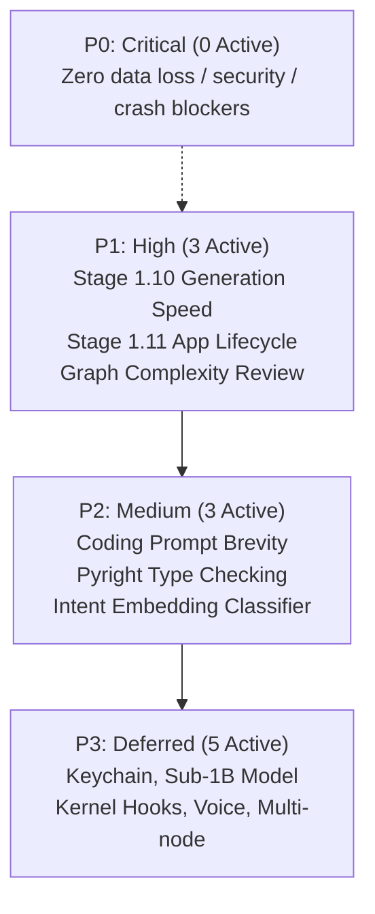

# Carbon 1.0.0 — Engineering Improvement Backlog

**Document Status:** Living Prioritized Engineering Backlog  
**Date:** 2026-10-29  
**Scope:** Phase 1 Closeout Refinements & Phase 2 Roadmap  
**Target Architecture:** Apple Silicon Mac (M5, macOS 27.x, 16 GB Unified Memory)  

---

## 1. Backlog Prioritization Schema

Issues, optimizations, and technical debt are categorized into four strict priority tiers:

- **P0 (Critical):** Correctness, security, data loss, crash, or freeze risks requiring immediate remediation.
- **P1 (High):** Major latency, reliability, process lifecycle, or usability problems affecting core user experience.
- **P2 (Medium):** Quality, prompt engineering, code cleanup, typing, and secondary performance refinements.
- **P3 (Low / Roadmap):** Architectural enhancements and deferred features scheduled for Phase 2.

---

## 2. P0: Correctness, Security or Data-Loss Risks

| ID | Title | Component | Description | Status |
|---|---|---|---|:---:|
| — | *None active* | — | All confirmed P0 issues (Markdown parser infinite loop, memory persistence desynchronization, WebSocket token leakage) have been completely resolved and verified by regression test suites. | **CLEAR** |

---

## 3. P1: Major Latency, Reliability or Usability Problems

### Item 1.10 — Stage 1.10: Token Generation Speed & Latency Optimization
- **Priority:** **P1**
- **Target Stage:** **Stage 1.10**
- **Component:** `OllamaProvider`, `CarbonModelSupervisor`, Prompt Architecture
- **Problem Statement:**  
  While Stage 1.9 eliminated the 90–198s thinking delays in Standard mode, long coding responses (>1,000 tokens) still require **60s to 71s** total duration (e.g. Kadane's algorithm took 71s in manual testing). This is governed by the physical generation speed of `qwen3.5:9b` on Apple M5 Metal GPU (~15–20 tokens/sec).
- **Target Metric:**  
  Reduce standard coding task wall-clock time from ~70s to $\le 30$ seconds.
- **Proposed Engineering Approaches:**
  1. *Prompt Conciseness Tuning:* Direct the model in Standard mode to provide production-ready code with concise docstrings and succinct bullet points rather than repetitive textbook narratives (reducing total tokens from 1,100 to ~450, yielding $\sim 25$s duration).
  2. *Ollama Metal/GPU Thread Optimization:* Evaluate `num_gpu`, `num_thread`, and batch evaluation parameters to increase raw tokens-per-second on M5.
  3. *Quantization / Model Size Evaluation:* Benchmark Q4_0 vs Q4_K_M, or evaluate a distilled 7B/4B coding model under CMS dynamic switching.

### Item 1.11 — Stage 1.11: Desktop Application Lifecycle & Process Management
- **Priority:** **P1**
- **Target Stage:** **Stage 1.11**
- **Component:** `CarbonApp.swift`, `CarbonClient.swift`, `main.py`
- **Problem Statement:**  
  Current native macOS client lacks sophisticated lifecycle handling when the backend crashes, restarts, or is launched multiple times. Finder activation vs Terminal launch behaviors need unified window management.
- **Proposed Engineering Approaches:**
  1. *Automatic Daemon Reconnection:* Harden the exponential backoff reconnection loop so that after a backend restart, the desktop client smoothly re-authenticates and restores conversation state without UI alert dialogs.
  2. *Single Instance Enforcement:* Ensure that opening Carbon via Finder or Dock focuses the existing window rather than spawning duplicate orphan instances.
  3. *Graceful Termination Signals:* Implement SIGTERM / SIGHUP handlers in `main.py` ensuring that running inference leases and database write-ahead logs cleanly flush before exit.

### Item 1.12 — Deep Algorithmic Reasoning & Graph Complexity Guidance
- **Priority:** **P1**
- **Target Stage:** Post-1.9 Refinement
- **Component:** `src/carbon/core/orchestrator.py` (System Prompt)
- **Problem Statement:**  
  In manual testing on negative-weight graph problems, the model provided Bellman–Ford ($O(V \cdot E)$) taking ~2.5 minutes. While correct for arbitrary graphs with negative cycles, it did not contextualize whether the graph was a DAG (where topological sort gives $O(V+E)$) or whether all-pairs shortest path was needed (where Johnson's algorithm is superior).
- **Proposed Engineering Approaches:**
  - Enhance Deep mode system prompt directives to require the model to explicitly state graph density assumptions and compare alternative algorithmic complexities.

---

## 4. P2: Quality and Performance Refinements

### Item 2.1 — Standard Mode Prompt Tuning for Code Brevity
- **Priority:** **P2**
- **Component:** `orchestrator.py`
- **Description:**  
  Tailor the system prompt for `ReasoningDepth.STANDARD` when coding intent is detected. Instruct the model: *"Provide the complete, working code implementation followed immediately by time/space complexity. Avoid introductory conversational preamble."*

### Item 2.2 — Static Type Checking Pipeline (Pyright)
- **Priority:** **P2**
- **Component:** CI / Development Tooling
- **Description:**  
  Install `pyright` in the virtual environment and add a `pyright src/` check to the standard quality gate to enforce zero type errors alongside `ruff` and `pytest`.

### Item 2.3 — Embedding-Based Intent Classifier
- **Priority:** **P2**
- **Component:** `IntelligenceEngine`
- **Description:**  
  Transition from regex keyword indicators to a lightweight embedding-based or sub-1B classification model for query routing to eliminate lexical edge cases.

---

## 5. P3: Deferred Features (Phase 2 Roadmap)

| Feature | Target Milestone | Architectural Reference | Description |
|---|---|---|---|
| **Native macOS Keychain Integration** | Phase 2 | ADR-0007 / `keychain-implementation-status.md` | Dual-custody token storage in Secure Enclave via `Security.framework`. |
| **Specialist Non-Reasoning Model** | Phase 2 | PRD FR-004 | Fast sub-1B parameter local model for instant conversational and system routing. |
| **Live Kernel Memory Pressure Hooks** | Phase 2 | PRD FR-005 | Native `DispatchSourceMemoryPressure` bridging Mach VM pressure to CMS. |
| **Local Voice Pipeline (STT / TTS)** | Phase 2 | PRD FR-006 | Whisper.cpp local transcription and Kokoro speech synthesis under $\le 500$ MB budget. |
| **Multi-Node Companion Pairing** | Phase 2 | PRD FR-012 | Secure local network state synchronization with Android companion devices. |

