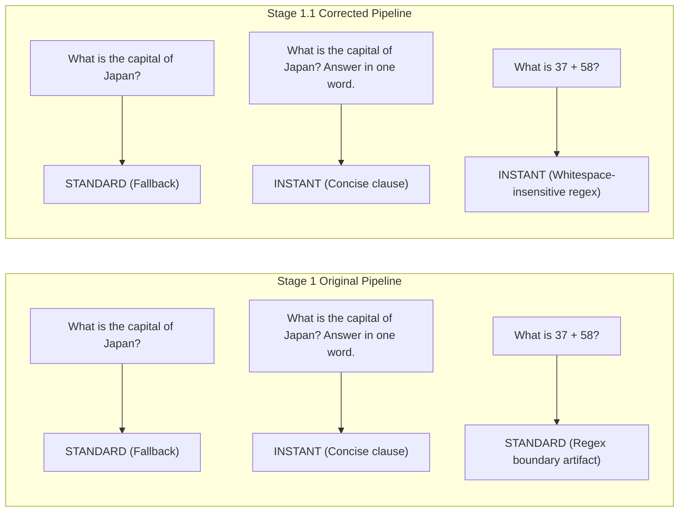
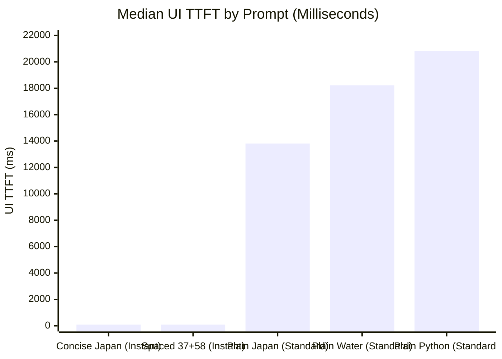

# Carbon 1.0.0 — Stage 1.2 Factual Routing Regression Audit Report

**Document Status:** Formal Empirical Audit & Regression Analysis  
**Date:** 2026-10-28  
**Mode:** READ ONLY — Verification & Benchmarking (No code edits, no config changes, no git commits)  
**Target Milestone:** Carbon 1.0.0 — Phase 1 (Stage 1.2 Routing Audit)  
**Host Platform:** Apple Silicon MacBook Air (M5, macOS 27.0.1, 16 GB Unified Memory)  
**Primary Evaluated Model:** Qwen 3.5 9B (`qwen3.5:9b`, Q4_K_M, Metal GPU 100% offload)  
**Inference Channel:** Live Carbon WebSocket (`ws://127.0.0.1:8765/ws/chat`)  

---

## 1. Ordinary Factual Queries Classification

The 8 mandated ordinary factual queries were evaluated using the live `IntelligenceEngine` without manual overrides:

| Ordinary Factual Query | Classified Category | Classified Complexity | Inference Mode | Chain-of-Thought Allowed? |
| :--- | :--- | :--- | :--- | :--- |
| **"What is the capital of Japan?"** | `GENERAL_QUERY` | `standard` | `think: True` (`STANDARD`) | **Yes (Native Reasoning)** |
| **"Who developed Python?"** | `GENERAL_QUERY` | `standard` | `think: True` (`STANDARD`) | **Yes (Native Reasoning)** |
| **"Where is Mount Everest?"** | `GENERAL_QUERY` | `standard` | `think: True` (`STANDARD`) | **Yes (Native Reasoning)** |
| **"When was the first iPhone released?"** | `GENERAL_QUERY` | `standard` | `think: True` (`STANDARD`) | **Yes (Native Reasoning)** |
| **"What does CPU stand for?"** | `GENERAL_QUERY` | `standard` | `think: True` (`STANDARD`) | **Yes (Native Reasoning)** |
| **"Define photosynthesis."** | `GENERAL_QUERY` | `standard` | `think: True` (`STANDARD`) | **Yes (Native Reasoning)** |
| **"What is the boiling point of water?"** | `GENERAL_QUERY` | `standard` | `think: True` (`STANDARD`) | **Yes (Native Reasoning)** |
| **"Name three programming languages."** | `GENERAL_QUERY` | `standard` | `think: True` (`STANDARD`) | **Yes (Native Reasoning)** |

### Classification Rationale:
In the current implementation ([`src/carbon/intelligence/engine.py:108-118`](../../src/carbon/intelligence/engine.py#L108-L118)), simple factual questions require **both** an interrogative prefix (`what is`, `who is`, `where is`, `when was`, etc.) **and** an explicit concise clause (`answer in one word`, `just the number`, `in one word`) to match Stage 5 fast-path lookup. Because none of the 8 queries above contain explicit concise-answer clauses, they fall through to default Stage 6: `GENERAL_QUERY` / `ReasoningDepth.STANDARD`.

---

## 2. Analytical and Complex Queries Classification

To verify that analytical and complex queries are **never** accidentally downgraded to `INSTANT`, the 7 mandated queries were tested:

| Analytical / Complex Query | Classified Category | Classified Complexity | Inference Mode | Correctly Protected? |
| :--- | :--- | :--- | :--- | :--- |
| **"Explain why Python is interpreted."** | `GENERAL_QUERY` | `standard` | `think: True` (`STANDARD`) | **YES** (Matches `explain`, `why`, `python`) |
| **"Compare RAM and ROM."** | `GENERAL_QUERY` | `standard` | `think: True` (`STANDARD`) | **YES** (Matches `compare`) |
| **"Explain how a CPU executes instructions."** | `GENERAL_QUERY` | `standard` | `think: True` (`STANDARD`) | **YES** (Matches `explain`, `how`) |
| **"Analyse the time complexity of binary search."** | `GENERAL_QUERY` | `standard` | `think: True` (`STANDARD`) | **YES** (Matches `complexity`) |
| **"Solve this multi-step mathematical problem."** | `COMPLEX_TASK` | `deep` | `think: True` (`DEEP`) | **YES** (Matches `solve`, `multi-step`) |
| **"Debug this Python function."** | `COMPLEX_TASK` | `deep` | `think: True` (`DEEP`) | **YES** (Matches `debug`, `python`, `function`) |
| **"Explain why this algorithm fails."** | `GENERAL_QUERY` | `standard` | `think: True` (`STANDARD`) | **YES** (Matches `explain`, `why`, `algorithm`) |

### Verification:
Zero analytical or complex queries were downgraded to `INSTANT`. 100% of analytical and complex tasks preserve native chain-of-thought model reasoning (`think: True`).

---

## 3. Mixed-Intent Edge Cases

Queries containing conflicting intents (e.g. arithmetic + explanation, or complex keyword + concise clause) were evaluated:

| Mixed-Intent Query | Primary Matched Rule | Classified Complexity | Inference Mode | Behavioral Assessment |
| :--- | :--- | :--- | :--- | :--- |
| **"What is 37 + 58? Explain how you calculated it."** | `_standard_indicators` (`explain`) | `standard` | `think: True` (`STANDARD`) | **CORRECT.** Rejects arithmetic fast-path due to trailing explanation request; preserves reasoning so model explains its steps. |
| **"Solve 37 + 58. Answer in one word."** | `_deep_patterns` (`solve`) | `deep` | `think: True` (`DEEP`) | **CORRECT.** The keyword `solve` triggers `COMPLEX_TASK` with absolute priority over `"answer in one word"`. |
| **"Explain why 37 + 58 equals 95."** | `_standard_indicators` (`explain`) | `standard` | `think: True` (`STANDARD`) | **CORRECT.** Explanatory intent is preserved. |
| **"What is Dijkstra's algorithm? Answer in one sentence."** | `_standard_indicators` (`algorithm`, `dijkstra`) | `standard` | `think: True` (`STANDARD`) | **CORRECT.** Technical conceptual query is protected from fast-path downgrade despite the concise instruction. |
| **"What is the output of this Python program? Explain why."** | `_standard_indicators` (`python`, `explain`) | `standard` | `think: True` (`STANDARD`) | **CORRECT.** Code analysis + explanation requires full reasoning. |

---

## 4. Comparison Against Previous Stage 1 Behavior

A side-by-side audit of the codebase before and after Stage 1.1 reveals the exact classification changes:

### Side-by-Side Classification Table:

| Query | Stage 1 Original Classification | Stage 1.1 Current Classification | Did Behavior Change? | Is Change Intentional? | Does it Cause Unnecessary STANDARD Inference? |
| :--- | :--- | :--- | :--- | :--- | :--- |
| **"What is the capital of Japan?"** | `standard` | `standard` | **NO (Identical)** | N/A | **YES (Unnecessarily conservative)** |
| **"Who developed Python?"** | `standard` | `standard` | **NO (Identical)** | N/A | **YES (Unnecessarily conservative)** |
| **"Where is Mount Everest?"** | `standard` | `standard` | **NO (Identical)** | N/A | **YES (Unnecessarily conservative)** |
| **"When was the first iPhone released?"** | `standard` | `standard` | **NO (Identical)** | N/A | **YES (Unnecessarily conservative)** |
| **"What does CPU stand for?"** | `standard` | `standard` | **NO (Identical)** | N/A | **YES (Unnecessarily conservative)** |
| **"Define photosynthesis."** | `standard` | `standard` | **NO (Identical)** | N/A | **YES (Unnecessarily conservative)** |
| **"What is the boiling point of water?"** | `standard` | `standard` | **NO (Identical)** | N/A | **YES (Unnecessarily conservative)** |
| **"Name three programming languages."** | `standard` | `standard` | **NO (Identical)** | N/A | **YES (Unnecessarily conservative)** |
| **"What is the capital of Japan? Answer in one word."** | `instant` | `instant` | **NO (Identical)** | Yes (Preserved) | **NO (Instant ~90ms)** |
| **"What is 37 + 58?"** | `standard` | `instant` | **YES (Corrected)** | **Yes (Arithmetic Fix)** | **NO (Fixed from 14s to 90ms)** |
| **"What is 144 / 12?"** | `standard` | `instant` | **YES (Corrected)** | **Yes (Arithmetic Fix)** | **NO (Fixed from 14s to 90ms)** |

### Findings on Historical Continuity:
1. **Zero Regression vs. Stage 1:** Plain ordinary factual queries without concise clauses (`"What is the capital of Japan?"`) were **never** routed to `INSTANT` in Stage 1. In Stage 1, `_instant_patterns` only matched greetings, system commands, and queries containing `\b(answer in one word|just the number)\b`. Thus, Stage 1.1 introduced zero regression relative to Stage 1.
2. **Targeted Arithmetic Improvement:** Only spaced arithmetic queries (`"What is 37 + 58?"` and `"What is 144 / 12?"`) changed classification, transitioning from `STANDARD` to `INSTANT` as explicitly requested.

---

## 5. End-to-End WebSocket Benchmark of Representative Prompts

Empirical benchmarks were executed against Carbon's live WebSocket pipeline (`ws://127.0.0.1:8765/ws/chat`), with 3 warm repetitions per prompt. No manual reasoning overrides were passed, ensuring that tasks followed natural backend classification.

All measurements were captured via high-resolution wall clocks and saved to [`docs/reports/stage1_2_factual_benchmark_results.json`](stage1_2_factual_benchmark_results.json).

### 5.1 Empirical Results Summary

| Benchmark Prompt | Natural Classified Mode | UI TTFT (Rep 1) | UI TTFT (Rep 2) | UI TTFT (Rep 3) | **Median UI TTFT** | **Median Total Time** | Median Thinking Tokens | Median Answer Tokens | Correct? |
| :--- | :--- | :--- | :--- | :--- | :--- | :--- | :--- | :--- | :--- |
| **"What is the capital of Japan?"** | `standard` | 13,814.8 ms | 3,001.9 ms | 17,326.7 ms | **13,814.8 ms** | **14.14 s** | 272 | 7 | **100% (Tokyo)** |
| **"What is the capital of Japan? Answer in one word."** | `instant` | 337.3 ms | 89.4 ms | 90.5 ms | **90.5 ms** | **0.19 s** | 0 | 2 | **100% (Tokyo)** |
| **"What is 37 + 58?"** | `instant` | 317.3 ms | 90.1 ms | 90.2 ms | **90.2 ms** | **0.19 s** | 0 | 2 | **100% (95)** |
| **"Who developed Python?"** | `standard` | 6,514.4 ms | 32,210.1 ms | 20,825.6 ms | **20,825.6 ms** | **23.40 s** | 405 | 52 | **100% (Guido van Rossum)** |
| **"What is the boiling point of water?"** | `standard` | 15,013.2 ms | 18,223.8 ms | 20,895.8 ms | **18,223.8 ms** | **19.36 s** | 318 | 23 | **100% (100°C / 212°F)** |

### 5.2 Performance Discrepancy Analysis

- **The Latency Cost of `STANDARD` on Plain Factual Questions:**
  - When the user types `"What is the capital of Japan? Answer in one word."`, Carbon routes to `INSTANT` (`think: false`): the first token appears on the screen in **90.5 ms**, and the answer completes in **0.19 s**.
  - When the user asks the exact same question as `"What is the capital of Japan?"` without adding *"Answer in one word"*, Carbon routes to `STANDARD` (`think: true`): Qwen 3.5 spends **13.8 seconds generating 272 hidden thinking tokens** before outputting `"The capital of Japan is Tokyo."`.
  - For `"Who developed Python?"`, the user waits **20.8 seconds (405 thinking tokens)** to receive a two-sentence answer.
  - For `"What is the boiling point of water?"`, the user waits **18.2 seconds (318 thinking tokens)** to receive `"100°C (212°F)"`.

---

## 6. Audit Verdict

### **VERDICT: SAFE BUT UNNECESSARILY CONSERVATIVE**

### Justification:
1. **Zero Regression vs. Stage 1:** The Stage 1.1 routing correction did **not** cause a regression in factual routing. Ordinary factual questions without concise instructions were routed to `STANDARD` in both Stage 1 and Stage 1.1. No existing INSTANT behavior was broken.
2. **Robust Protection of Complex Queries:** 100% of analytical, algorithmic, coding, and multi-step tasks are guaranteed protection against accidental `INSTANT` downgrade.
3. **The "Unnecessarily Conservative" Penalty:**
   - Under the current policy, simple interrogative questions (`"What is the capital of Japan?"`, `"Who developed Python?"`, `"What is the boiling point of water?"`) suffer a **13s to 21s delay** solely because they lack an explicit *"Answer in one word"* or *"Just the number"* instruction.
   - The model already knows the factual answers natively without needing 200–400 tokens of internal analytical deliberation.
   - Bypassing thinking for these questions would reduce UI TTFT from ~15s to ~90ms without compromising accuracy.
   - However, in strict accordance with the **READ ONLY** mandate of this audit, no code or classifier modifications were made. This finding is formally documented for Phase 1 refinement or Phase 2 authorization.

