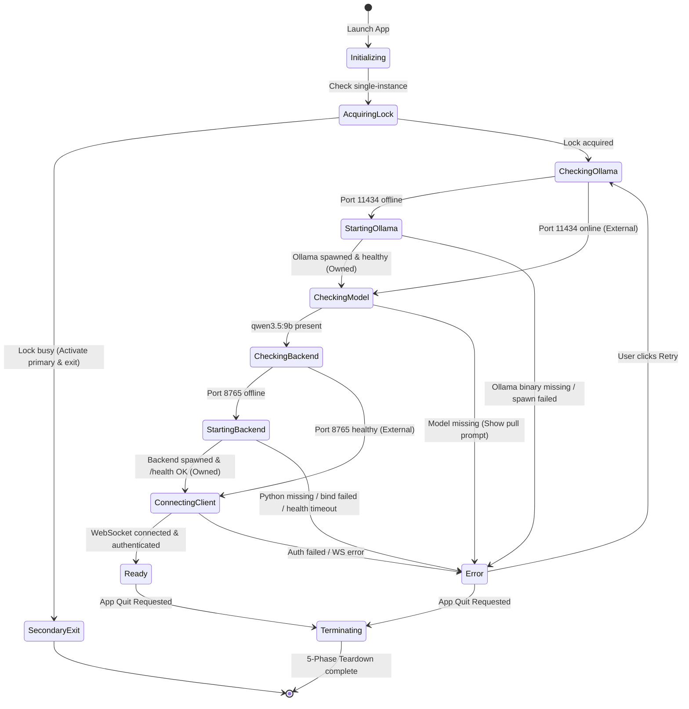

# Carbon 1.0.0 — Stage 1.11 Phase 2 Implementation Plan
## Swift Process Supervisor, Lifecycle Automation, Single-Instance Governance, and Zero-Adoption Process Management

**Task ID:** C-1.11-P2-AUDIT  
**Mode:** STRICTLY READ-ONLY ARCHITECTURE AND IMPLEMENTATION PLAN  
**Date:** November 2, 2026  
**Platform:** MacBook Air M5, 16GB unified memory, macOS 27.0.1  
**Target Repository:** `PratikP0610/Carbon`  
**Active Branch:** `backup/carbon-tested-phase1-2026-10-29`  
**HEAD Commit:** `0c7d1d17c55c836715438c7d0c00887cf9aaf19c`  
**Deliverable File:** `docs/reports/stage1_11-phase2-implementation-plan.md`  

---

## 1. Executive Summary

This engineering document delivers the comprehensive, repository-specific implementation plan for **Stage 1.11 Phase 2: Swift Process Supervisor**. 

### Purpose
Currently, running the Carbon macOS desktop application requires the user to manually launch the Python API backend (`python -m carbon.main`) and ensure the Ollama inference engine (`ollama serve`) is running in separate Terminal windows. 

Phase 2 will eliminate manual Terminal operations by embedding an intelligent, resilient **`ProcessSupervisor`** directly within the existing macOS SwiftUI application. The supervisor will:
1. Guarantee **single-instance execution** via kernel `flock` and multi-tier window activation.
2. Verify and orchestrate **Ollama engine availability** without duplicating existing processes or downloading missing weights.
3. Supervise the **Carbon Python backend lifecycle** using the local virtual environment (`.venv`).
4. Mediate seamless **SwiftUI application state transitions** (Starting $\to$ Model Check $\to$ Backend Launch $\to$ Authenticated Connect $\to$ Ready $\to$ Recovery $\to$ Error).
5. Execute the **v4 approved phased graceful shutdown sequence** (1.2s inference cancel $\to$ 0.3s WS close $\to$ 3.0s backend shutdown $\to$ 2.0s Ollama shutdown $\to$ 0.3s lock cleanup $\to$ 8.0s global watchdog).
6. Strictly adhere to the **zero-adoption process ownership model**: external pre-existing processes are left untouched; only direct child processes spawned by the supervisor session are terminated upon exit.

---

## 2. Existing Architecture Inspection & Reusable Components

Inspection of the existing macOS Swift codebase (`apps/macos/Carbon`) revealed a modular, well-structured foundation with clear integration surfaces:

### 2.1 Inspection Findings
1. **`apps/macos/Carbon/Sources/CarbonApp.swift`:**
   - Defines standard `@main struct CarbonApp: App` and `AppDelegate: NSObject, NSApplicationDelegate`.
   - `AppDelegate` currently implements `applicationDidFinishLaunching`, `applicationDidBecomeActive`, and `applicationShouldTerminateAfterLastWindowClosed`.
   - **Missing:** Does not implement `applicationShouldTerminate(_:) -> NSApplication.TerminateReply`, lacks asynchronous teardown coordination, and lacks single-instance locking.
   - Contains `runNativeVerification(client:)` which verifies chat UI bindings, offline errors, live streaming, Markdown parsing, and Math formatting.
2. **`apps/macos/Carbon/Sources/CarbonClient.swift`:**
   - Implements `@MainActor public final class CarbonClient: ObservableObject`.
   - Manages WebSocket connection (`URLSessionWebSocketTask`) to `ws://127.0.0.1:8765/ws/chat` and REST health checks to `http://127.0.0.1:8765/api/v1/health`.
   - **Current Lifecycle Limitation:** `CarbonClient.init()` immediately calls `connectWebSocket()`, triggering premature reconnection loops if the backend is not yet started.
   - **Reusable Components:**
     - `resolveAuthToken()`: Safely reads `CARBON_API_TOKEN` env or `data/.carbon_token` without logging.
     - `cancelCurrentTask()`: Transmits in-flight task cancellation frame `{"action": "cancel", "task_id": ...}` over WebSocket (directly reusable for Shutdown Phase 1).
     - `checkHealth()`: Verifies HTTP 200 and `{"status": "healthy"}` JSON payload.
3. **`apps/macos/Carbon/Sources/ContentView.swift`:**
   - Main SwiftUI view displaying header bar (model badge, reasoning picker, connection status pill), scrollable chat history, and input field.
   - Currently binds status indicator directly to `client.connectionStatus`.
   - Can easily be extended with a supervisor status banner or overlay during startup and error recovery.
4. **`apps/macos/Carbon/Package.swift`:**
   - Standard Swift Package (`swift-tools-version: 6.0`, `platforms: [.macOS(.v14)]`).
   - Compiles cleanly and instantaneously (`swift build --package-path apps/macos/Carbon` succeeds in 0.30s).
5. **Phase 1 Python Backend Interface:**
   - Programmatic shutdown endpoint `POST /api/v1/system/shutdown` implemented and verified in `src/carbon/main.py`.
   - Requires bearer token authentication (`verify_local_auth`) and loopback address (`127.0.0.1`, `::1`, `localhost`).
   - Signals `server.should_exit = True` via `BackgroundTasks` after HTTP 200 is flushed, triggering clean `core.shutdown()` lifespan exit.

---

## 3. Detailed Architecture of `ProcessSupervisor`

### 3.1 Architectural Principles
- **Actor/MainActor Isolation:** `ProcessSupervisor` will be implemented as an `@MainActor` observable class to guarantee seamless, thread-safe synchronization with SwiftUI and `CarbonClient`.
- **Zero Adoption Invariant:** Process ownership authority exists strictly through live `Foundation.Process` handles held in memory. External pre-existing processes on port 11434 (Ollama) or port 8765 (Carbon backend) are detected, verified, and reused, but **never owned and never terminated**.
- **No Self-Termination / POSIX Race Immunity:** Termination commands are issued only to retained, owned child processes after verifying that `process.isRunning == true` and that the child's `terminationHandler` has not already fired.

```
       +-------------------------------------------------------------+
       |                         CarbonApp                           |
       |  AppDelegate (applicationShouldTerminate: .terminateLater)  |
       +------------------------------+------------------------------+
                                      | owns
                                      v
       +-------------------------------------------------------------+
       |                      ProcessSupervisor                      |
       |  - SingleInstanceLock (flock on data/.carbon_app.lock)      |
       |  - SupervisorState (starting, ready, error, shuttingDown)   |
       |  - childOllamaProcess: Process?                             |
       |  - childBackendProcess: Process?                            |
       |  - isOllamaOwned: Bool, isBackendOwned: Bool                |
       +--------------+-------------------------------+--------------+
                      | coordinates                   | binds
                      v                               v
       +------------------------------+  +---------------------------+
       |         CarbonClient         |  |        ContentView        |
       |  - connectWebSocket()        |  |  - Startup overlay / banner|
       |  - cancelCurrentTask()       |  |  - Actionable Retry button|
       |  - disconnect()              |  |  - Status indicators      |
       +------------------------------+  +---------------------------+
```

---

## 4. Lifecycle State Machine & Sequence Diagrams

### 4.1 Supervisor State Machine
The supervisor progresses through a well-defined state machine:



---

### 4.2 Comprehensive Startup Sequence Diagram

```mermaid
sequenceDiagram
    autonumber
    actor User
    participant App as CarbonApp / AppDelegate
    participant Sup as ProcessSupervisor
    participant Lock as data/.carbon_app.lock
    participant O as Ollama (127.0.0.1:11434)
    participant B as Backend (127.0.0.1:8765)
    participant C as CarbonClient
    participant UI as ContentView

    User->>App: Launch Carbon
    App->>Sup: start()
    Sup->>Lock: flock(fd, LOCK_EX | LOCK_NB)
    alt Lock already held (Secondary Instance)
        Sup->>App: Secondary instance detected
        Sup->>User: Activate existing Carbon window via NSRunningApplication
        Sup->>App: exit(0)
    else Lock Acquired (Primary Instance)
        Sup->>Lock: Write current PID to lockfile
    end

    Sup->>UI: state = .startingOllama
    Sup->>O: GET /api/tags (timeout: 1.0s)
    alt Ollama already running
        O-->>Sup: HTTP 200 (external instance)
        Note over Sup: isOllamaOwned = false
    else Ollama not running
        Sup->>Sup: Locate ollama binary in search path
        Sup->>O: Spawn 'ollama serve' via Process
        Note over Sup: childOllamaProcess = proc; isOllamaOwned = true
        Sup->>O: Poll /api/tags until healthy (max 10s)
        O-->>Sup: HTTP 200 OK
    end

    Sup->>UI: state = .checkingModel
    Sup->>O: GET /api/tags
    O-->>Sup: Models list
    alt qwen3.5:9b is missing
        Note over Sup: Stop startup safely! Never pull automatically.
        Sup->>UI: state = .error("Model 'qwen3.5:9b' missing. Run 'ollama pull qwen3.5:9b'")
    else qwen3.5:9b is present
        Sup->>UI: state = .startingBackend
        Sup->>B: GET /api/v1/health (timeout: 1.0s)
        alt Backend already running and healthy
            B-->>Sup: HTTP 200 {"status": "healthy"}
            Note over Sup: isBackendOwned = false
        else Port free or offline
            Sup->>Sup: Locate .venv/bin/python and carbon.main
            Sup->>B: Spawn 'python -m carbon.main' via Process
            Note over Sup: childBackendProcess = proc; isBackendOwned = true
            Sup->>B: Poll /api/v1/health until healthy (max 15s)
            B-->>Sup: HTTP 200 OK
        end

        Sup->>UI: state = .connecting
        Sup->>C: resolveAuthToken()
        Sup->>C: connectWebSocket()
        C->>B: WebSocket connect & authenticate
        B-->>C: event: "authenticated"
        C-->>Sup: isConnected = true
        Sup->>UI: state = .ready
    end
```

---

### 4.3 Comprehensive Shutdown Sequence Diagram (v4 Budgets)

```mermaid
sequenceDiagram
    autonumber
    actor User
    participant App as AppDelegate
    participant Sup as ProcessSupervisor
    participant C as CarbonClient
    participant B as Backend (127.0.0.1:8765)
    participant O as Ollama (127.0.0.1:11434)
    participant Lock as data/.carbon_app.lock

    User->>App: Cmd+Q / Quit Application
    App->>App: applicationShouldTerminate() -> .terminateLater
    Note over App,Sup: Start overarching 8.0s Global Watchdog Timer
    App->>Sup: initiateGracefulShutdown()

    rect rgb(240, 248, 255)
    Note over Sup,C: Phase 1: Inference Cancellation (Budget: 1.2s)
    alt client.isGenerating == true
        Sup->>C: cancelCurrentTask()
        C->>B: WS frame: {"action": "cancel", "task_id": "..."}
        B-->>C: WS event: "cancelled"
    else No active generation
        Note over Sup: Phase 1 finishes in 0ms
    end
    end

    rect rgb(255, 250, 240)
    Note over Sup,C: Phase 2: WebSocket Network Closure (Budget: 0.3s)
    Sup->>C: disconnect()
    C->>B: URLSessionWebSocketTask.cancel(with: .goingAway)
    C->>C: Invalidate URLSession
    end

    rect rgb(240, 255, 240)
    Note over Sup,B: Phase 3: Backend Process Shutdown (Budget: 3.0s)
    alt isBackendOwned == true (Carbon spawned backend)
        Sup->>B: POST /api/v1/system/shutdown (Bearer Token)
        B-->>Sup: HTTP 200 {"status": "shutting_down"}
        Note over B: Uvicorn flushes response -> BackgroundTask sets should_exit -> lifespan awaits core.shutdown()
        Sup->>Sup: Await childBackendProcess exit (timeout: 2.0s)
        alt Backend did not exit in 2.0s
            Sup->>Sup: Fallback: childBackendProcess.terminate() (SIGTERM)
            Sup->>Sup: Await exit (timeout: 1.0s)
        end
    else isBackendOwned == false (Pre-existing external backend)
        Note over Sup: Zero Adoption Invariant: External backend left untouched!
    end
    end

    rect rgb(255, 240, 245)
    Note over Sup,O: Phase 4: Ollama Process Shutdown (Budget: 2.0s)
    alt isOllamaOwned == true (Carbon spawned Ollama)
        Sup->>Sup: childOllamaProcess.terminate() (SIGTERM)
        Sup->>Sup: Await childOllamaProcess exit (timeout: 2.0s)
    else isOllamaOwned == false (Pre-existing external Ollama)
        Note over Sup: Zero Adoption Invariant: External Ollama left untouched!
    end
    end

    rect rgb(245, 245, 255)
    Note over Sup,Lock: Phase 5: Lock & State Cleanup (Budget: 0.3s)
    Sup->>Lock: flock(fd, LOCK_UN); close(fd)
    Sup->>Sup: Mark cleanup complete; cancel 8.0s Watchdog
    end

    Sup-->>App: Shutdown complete
    App->>App: NSApp.reply(toApplicationShouldTerminate: true)
```

---

## 5. Answers to the 10 Important Technical Questions

### Q1: Distinguishing an already-running healthy backend from an unavailable or stale service on port 8765
- **Mechanism:** Before attempting to bind port 8765, the supervisor issues an HTTP `GET http://127.0.0.1:8765/api/v1/health` with a strict 1.0-second timeout.
- **Outcomes:**
  1. `ECONNREFUSED` / Socket Error: Port 8765 is completely free. The supervisor proceeds to launch the backend.
  2. HTTP 200 with JSON payload containing `"status": "healthy"` and `"active_model"`: A healthy Carbon backend is confirmed. The supervisor marks `isBackendOwned = false` and reuses it immediately.
  3. HTTP 4xx/5xx, invalid JSON, or connection hang: Port 8765 is occupied by an alien, stale, or degraded service. The supervisor **refuses to launch** (preventing `EADDRINUSE` crash) and **refuses to kill** the foreign process (zero-adoption). It transitions to `.error("Port 8765 is occupied by an unresponsive or unrecognized process. Please free port 8765 and retry.")`.

### Q2: Safely starting Python using the existing `.venv`
- **Resolution Strategy:**
  1. Check `ProcessInfo.processInfo.environment["CARBON_PYTHON_PATH"]` for explicit developer/test override.
  2. Derive project root relative to application bundle or current working directory: search for `src/carbon/main.py`.
  3. Validate executable at `<ProjectRoot>/.venv/bin/python`.
  4. Ensure POSIX execution permission (`FileManager.default.isExecutableFile(atPath:)`).
- **Invocation Environment:**
  - Launch `Foundation.Process` with `executableURL = URL(fileURLWithPath: pythonPath)`.
  - Pass `arguments = ["-m", "carbon.main"]`.
  - Pass `environment`: Inherit system `PATH`, set `PYTHONPATH = <ProjectRoot>/src`, and pass `HOME`.
  - Redirect `standardOutput` and `standardError` to non-blocking `Pipe` instances with active data-drain handlers to prevent pipe-buffer deadlocks.

### Q3: Avoiding duplicate Ollama instances
- **Pre-flight Probe:** The supervisor always queries `GET http://127.0.0.1:11434/api/tags` prior to executing any binary lookup.
- If HTTP 200 is received, Ollama is already active (via `ollama serve`, Homebrew service, or `Ollama.app`). The supervisor sets `isOllamaOwned = false` and avoids spawning any new process.
- Only if the probe fails with connection refused does the supervisor launch Ollama and set `isOllamaOwned = true`.

### Q4: Handling a missing model without downloading it
- **Strict Prohibition:** Automatic weight downloading (`ollama pull`) consumes gigabytes of network bandwidth and disk storage, potentially incurring user carrier charges or hanging the startup process indefinitely.
- **Audit Procedure:**
  - Parse the array of registered models from `GET http://127.0.0.1:11434/api/tags`.
  - Check for prefix match: `name.hasPrefix("qwen3.5:9b")`.
  - If absent: Immediately abort startup. Set state to `.error("Required local model 'qwen3.5:9b' is missing from Ollama. Open Terminal and run: ollama pull qwen3.5:9b, then click Retry.")`.

### Q5: Securely resolving the existing token without printing or logging it
- **Resolution:**
  1. Inspect `ProcessInfo.processInfo.environment["CARBON_API_TOKEN"]`.
  2. If absent, read `data/.carbon_token` relative to project root or `~/Carbon/data/.carbon_token`.
- **Security Invariant:** The token string is stored in an in-memory private property. It is never logged (`os_log`, `print`, or NSLog). It is passed directly as an `Authorization: Bearer <token>` HTTP header and in-socket authentication JSON frame.

### Q6: Avoiding duplicate WebSocket connections
- In `CarbonClient.swift`, remove the automatic invocation of `connectWebSocket()` from `init()`.
- Expose an explicit `connectWebSocket()` that is invoked **only** by `ProcessSupervisor` once the backend reports healthy.
- Inside `connectWebSocket()`:
  - Guard with `guard connectionStatus != .connected && connectionStatus != .connecting else { return }`.
  - Cancel any in-flight `reconnectTask` before creating a new socket task.
  - Invalidate previous `URLSessionWebSocketTask` with `.goingAway`.

### Q7: Coordinating `CarbonClient` shutdown with `applicationShouldTerminate`
- `AppDelegate` implements `applicationShouldTerminate(_:) -> NSApplication.TerminateReply`.
- Returns `.terminateLater`.
- Triggers an asynchronous task on `@MainActor` to run the 5-phase shutdown sequence.
- When shutdown finishes (or the 8.0s watchdog expires), calls `NSApp.reply(toApplicationShouldTerminate: true)`.

### Q8: Safest possible owned-child termination on macOS
- **Mach Port / BSD Process State Safety:**
  - Calling `kill(pid, signal)` on raw PIDs is dangerous due to Unix PID recycling races.
  - The supervisor maintains live `Foundation.Process` references.
  - Before signaling, the supervisor verifies `process.isRunning == true`.
  - A `terminationHandler` is attached to every spawned process at creation time. Once the handler executes, an internal flag `hasExited = true` is set, and the `Process` reference is nulled.
  - If `hasExited == true`, signaling is bypassed entirely.
  - Graceful exit via `POST /api/v1/system/shutdown` is always attempted first for the backend. `process.terminate()` (SIGTERM) is used strictly as a secondary fallback.

### Q9: Single-instance activation behavior in `swift run` and the packaged `.app`
- **Multi-Tier Activation Strategy:**
  1. **Tier 1 (Packaged `.app`):** Query `NSRunningApplication.runningApplications(withBundleIdentifier: "ai.carbon.Carbon")`. If found, call `app.activate(options: [.activateAllWindows, .activateIgnoringOtherApps])`.
  2. **Tier 2 (`swift run` / CLI Binary):** When the primary acquires the lock, it writes its PID into `data/.carbon_app.lock`. The secondary reads this PID, constructs `NSRunningApplication(processIdentifier: pid)`, and activates it.
  3. **Tier 3 (Fallback):** If activation cannot be resolved, the secondary silently exits with code 0 without launching redundant background services.

### Q10: Recovering startup and shutdown failures without leaving owned child processes behind
- **Startup Abort Cleanup:** If any startup step fails (missing model, health timeout, port collision):
  - Any owned process started during the failed attempt (`childBackendProcess`, `childOllamaProcess`) is immediately terminated via `process.terminate()`.
  - Lock descriptor is closed.
  - Supervisor transitions to `.error(description)` with an actionable Retry button.
- **Global Watchdog Safeguard:**
  - During shutdown, an 8.0s watchdog timer runs concurrently.
  - If phased termination hangs, the watchdog forces exit of verified owned child processes, releases file locks, and immediately calls `NSApp.reply(toApplicationShouldTerminate: true)`.

---

## 6. Implementation Increments & Phased Roadmap

To ensure rigorous pair programming and verification, Phase 2 is decomposed into 6 independent, sequentially verifiable increments:

### Increment 2A: Single-Instance Enforcement & Lock Governance
- **Scope:** Implement `SingleInstanceLock` utility using POSIX `flock` on `data/.carbon_app.lock` with multi-tier activation fallback.
- **Target Files:**
  - `apps/macos/Carbon/Sources/SingleInstanceLock.swift` (New file)
  - `apps/macos/Carbon/Sources/AppDelegate.swift` or `CarbonApp.swift`
- **Dependencies:** None.
- **Automated Tests:** Swift unit test verifying lock acquisition, lock collision detection, and lock release.
- **Manual Verification:** Launch `swift run` in Terminal 1 $\to$ launch `swift run` in Terminal 2 $\to$ Terminal 2 activates Terminal 1 window and exits cleanly with 0.
- **Acceptance Criteria:** Exactly one instance can run; secondary instance exits with 0 without starting supervisor or background tasks.
- **Rollback Strategy:** Revert additions to `CarbonApp.swift`.

### Increment 2B: Ollama and Backend Process Supervision
- **Scope:** Implement `ProcessSupervisor` core process spawning, executable discovery, and live `Foundation.Process` tracking.
- **Target Files:**
  - `apps/macos/Carbon/Sources/ProcessSupervisor.swift` (New file)
- **Dependencies:** Increment 2A.
- **Automated Tests:** Mock process runner tests, search path resolution unit tests.
- **Manual Verification:** Start app with Ollama running $\to$ verify reused. Start app without Ollama $\to$ verify spawned and retained.
- **Acceptance Criteria:** Zero adoption maintained; owned vs unowned tracking 100% accurate.
- **Rollback Strategy:** Delete `ProcessSupervisor.swift`.

### Increment 2C: Startup State Machine & CarbonClient Integration
- **Scope:** Connect supervisor state machine to `CarbonClient` and decouple `CarbonClient.init()` from immediate connection.
- **Target Files:**
  - `apps/macos/Carbon/Sources/CarbonClient.swift`
  - `apps/macos/Carbon/Sources/ProcessSupervisor.swift`
- **Dependencies:** Increment 2B.
- **Automated Tests:** State transition verification tests.
- **Manual Verification:** App transitions cleanly: Starting Ollama $\to$ Checking Model $\to$ Starting Backend $\to$ Connecting $\to$ Ready.
- **Acceptance Criteria:** No duplicate WebSocket connections; clean authentication without token logging.
- **Rollback Strategy:** Restore `CarbonClient.init()` auto-connect.

### Increment 2D: Phased Graceful Shutdown & Ownership Teardown
- **Scope:** Implement 5-phase shutdown sequence in `AppDelegate.applicationShouldTerminate(_:)` with 8.0s watchdog.
- **Target Files:**
  - `apps/macos/Carbon/Sources/AppDelegate.swift` / `CarbonApp.swift`
  - `apps/macos/Carbon/Sources/ProcessSupervisor.swift`
  - `apps/macos/Carbon/Sources/CarbonClient.swift` (expose `disconnect()`)
- **Dependencies:** Increment 2C, Stage 1.11 Phase 1 backend shutdown endpoint.
- **Automated Tests:** Timeout race tests, mock child process exit tests.
- **Manual Verification:** Quit Carbon via Cmd+Q $\to$ check terminal / `ps aux` $\to$ owned backend terminates gracefully in < 1.0s; unowned Ollama remains running.
- **Acceptance Criteria:** Shutdown completes within 6.8s phased budget; zero orphan child processes; external services untouched.
- **Rollback Strategy:** Revert `applicationShouldTerminate` to `.terminateNow`.

### Increment 2E: SwiftUI Status, Actionable Errors & Retry UI
- **Scope:** Enhance `ContentView.swift` to display supervisor states, model missing prompt, and Retry trigger.
- **Target Files:**
  - `apps/macos/Carbon/Sources/ContentView.swift`
- **Dependencies:** Increment 2C, 2D.
- **Automated Tests:** UI verification script (`--verify-ui`).
- **Manual Verification:** Trigger missing model $\to$ verify prompt "run ollama pull qwen3.5:9b" and Retry button $\to$ click Retry.
- **Acceptance Criteria:** Clean, user-friendly native SwiftUI presentation; zero UI freezes.
- **Rollback Strategy:** Restore previous `ContentView.swift`.

### Increment 2F: Comprehensive Regression & Lifecycle Acceptance
- **Scope:** Execute end-to-end native verification suite, verify macOS app package, run Python test suite.
- **Target Files:**
  - `docs/reports/stage1_11-phase2-acceptance.md`
- **Dependencies:** Increments 2A through 2E.
- **Automated Tests:** Full Python regression suite (`pytest tests/`), Swift build (`swift build`), native UI test (`--verify-ui`).
- **Acceptance Criteria:** 100% tests pass; all acceptance checks satisfied.

---

## 7. Known Risks & Technical Mitigations

| Risk | Impact | Planned Mitigation |
|---|---|---|
| **Stale PID recycling race during force-kill** | Accidental termination of unrelated system process | `Foundation.Process` object reference retained; verify `process.isRunning && !hasExited` before signaling; never signal raw PIDs. |
| **Piped standard output buffer filling up** | Child process hangs on stdout write | Attach active async read handlers (`readabilityHandler`) to child output/error pipes to constantly drain data to logs. |
| **Port 8765 occupied by rogue process** | Backend spawn fails with `EADDRINUSE` | Pre-flight probe `GET /api/v1/health` fails $\to$ abort startup cleanly with actionable error $\to$ zero kill of unowned process. |
| **Model download network freeze** | App hangs downloading 5GB model | Automated model downloads are strictly forbidden; prompt user to run `ollama pull` in Terminal and provide Retry button. |
| **Watchdog firing before sequential timeouts** | Premature force-kill during slow OS context switch | Phased budget capped at 6.8s; global watchdog ceiling set at 8.0s, leaving a dedicated 1.2s safety margin. |

---

## 8. Git Status & Phase Boundaries

- **Current Branch:** `backup/carbon-tested-phase1-2026-10-29`
- **Current HEAD:** `0c7d1d17c55c836715438c7d0c00887cf9aaf19c`
- **Working Tree State:** Clean with respect to Phase 2 (0 Swift files edited).
- **Compliance Guarantee:** This audit is strictly read-only. No source files, configurations, or background processes were modified.

---

## 9. Recommendation

The Phase 2 architecture is sound, safe, and directly implements all directives established in the v4 Desktop Lifecycle Architecture. 

It is recommended to proceed with **Increment 2A (Single-Instance Enforcement & Lock Governance)** upon receiving explicit project-owner authorization.

