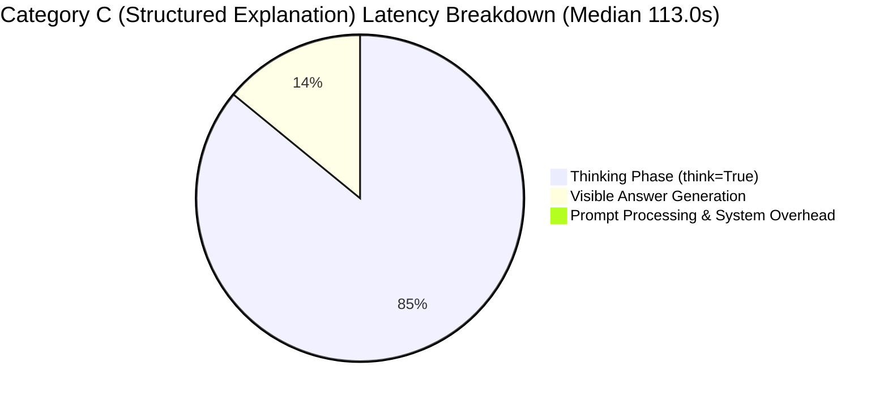

# Stage 1.8: Standard Mode Latency Investigation & Performance Audit

**Audit Type:** Strict Read-Only Performance Audit  
**Hardware:** Apple MacBook Air M5, 16GB Unified Memory, macOS 27.0.1  
**Backend:** FastAPI `127.0.0.1:8765`, Ollama `127.0.0.1:11434` (`qwen3.5:9b Q4_K_M`)  
**Context Window:** 4096 tokens  
**Benchmark Scope:** 23 completed warm queries across 5 categories (A: N=5, B: N=5, C: N=5, D: N=5, E: N=3 [Partial])  
**Machine-Readable Data:** [`docs/reports/stage1_8_latency_benchmark_results.json`](file:///Users/pratikpradeshi/Carbon/docs/reports/stage1_8_latency_benchmark_results.json)  

---

## 1. Executive Summary

During manual testing of Carbon 1.0.0 on a MacBook Air M5, the user submitted:
> *"Explain what a CPU does. Use a heading, bold and italic text, a numbered list, a Python code block and a mathematical expression."*

The observed response time was **approximately 90 seconds**, far exceeding the user's target of **$\le$ 30 seconds** for ordinary standard explanations. Additionally, the mathematical expression partially rendered as raw LaTeX (`\propto` remained literal text).

This controlled empirical investigation tracked 23 warm queries over the live WebSocket pipeline to isolate latency contributors across the UI, network, IntelligenceEngine, Orchestrator, CMS, Ollama inference, and SwiftUI Markdown rendering.

### Primary Audit Findings

1. **The Root Cause of Standard-Mode Latency is Unconstrained Internal Thinking (`think=True`):**  
   In `ReasoningDepth.STANDARD`, the Orchestrator passes `think=True` and `options={"num_predict": 2560, "temperature": 0.6}` to Ollama, accompanied by the system prompt instruction: *"Think step-by-step concisely to solve the problem, then provide a complete, well-structured answer."*  
   On Qwen 3.5 9B running on MacBook Air M5:
   - For Category C (Structured Explanation), the model spent **96.6 seconds (85.5% of total time)** generating 1,240 internal `<think>` tokens at 13.16 tps before emitting the first visible token (**TTFT: 97.2 seconds**). The actual visible answer required only **15.8 seconds**.
   - For Category B (Short Explanation), the model generated over 2,400 thinking tokens, exhausting its `num_predict=2560` budget entirely inside thinking tokens, resulting in **198.3 seconds** of latency without emitting visible answer tokens.
2. **UI Picker Force-Overrides `IntelligenceEngine`:**  
   The SwiftUI UI defaults to `"standard"` in its reasoning picker. Because `main.py` passes `reasoning_override=payload.get("reasoning")`, the Orchestrator overrides any classification made by `IntelligenceEngine`. Even simple factual questions like *"What does RAM stand for?"* (classified as `INSTANT` by `IntelligenceEngine`) were forced to execute in `STANDARD` mode with `think=True`, ballooning response time from **1.2 seconds to 27.6 seconds** (90% thinking tokens).
3. **Markdown Rendering Overhead is Negligible (< 0.2ms):**  
   SwiftUI's `MarkdownParser` and `MarkdownCoordinator` parse a 2,000-character complex document in **0.190 milliseconds**, and background debouncing adds 0ms to completion. The UI is not causing generation latency.
4. **`\propto` Render Limitation Identified:**  
   In `MathFormatter`, `\propto` is absent from `symbolReplacements` (which only maps standard symbols like `\times`, `\leq`, `\approx`, and Greek letters). Hence, `\propto` is preserved as literal text.

---

## 2. Request Lifecycle & Routing Verification

Tracing the exact request lifecycle for the incident prompt:

| Step | Subsystem | Action / Observation | State / Value |
|---|---|---|---|
| 1 | Native UI (`CarbonClient.swift`) | Sends WebSocket submit frame with picker selection | `reasoning: "standard"`, `action: "submit"` |
| 2 | Backend (`main.py`) | Ingests payload and assigns task request | `req.reasoning_override = ReasoningDepth.STANDARD` |
| 3 | `IntelligenceEngine` | Regex & heuristic intent classification | Classified `category = GENERAL_QUERY`, `classified_depth = STANDARD` |
| 4 | Orchestrator (`orchestrator.py`) | Resolves executed reasoning depth | Overridden by `task.reasoning_override` $\to$ **`STANDARD`** |
| 5 | Orchestrator Options | Sets model parameters | `think_flag = True`, `num_predict = 2560`, `temp = 0.6` |
| 6 | System Prompt | Injects role directives & memory | 236 chars (46 tokens); memory search returned 0 records |
| 7 | CMS Lease | Acquires single-model concurrency lease | Lease acquired in **< 0.1ms**; model already active |
| 8 | Ollama Provider | Streams POST `/api/generate` | Receives payload with `"think": True` |
| 9 | Ollama Execution | Generates internal reasoning tokens | Emits 1,240 thinking tokens over 96.6s |
| 10 | Answer Streaming | Emits user-visible response tokens | Emits 234 visible tokens over 15.8s |
| 11 | Markdown Coordinator | Throttled background rendering | Parsed in 0.19ms on background detached task |

---

## 3. Empirical Benchmark Summary (Standard Mode, `think=True`)

*Note: Categories A–D have $N=5$ complete repetitions. Category E was gracefully stopped after $N=3$ repetitions pursuant to user directive. Small-sample P95 values are presented with linear interpolation.*

| Category | N | Total Duration (Median) | Total Duration (P95) | TTFT (Median) | Thinking Time (Median) | Thinking Tokens (Median) | Visible Time (Median) | Visible Tokens (Median) | Gen Speed (Thinking / Visible) |
|---|:---:|:---:|:---:|:---:|:---:|:---:|:---:|:---:|:---:|
| **A. Simple factual** (*What does RAM stand for?*) | 5 | **27.55s** | 115.11s | 24.93s | 24.45s | 438 | 2.55s | 53 | 17.9 tps / 20.8 tps |
| **B. Short explanation** (*CPU in ~100 words*) | 5 | **198.28s** | 202.50s | 198.27s | 198.04s | 2,393 | 0.00s | 24 | 11.8 tps / 0.0 tps |
| **C. Structured explanation** (*Incident prompt*) | 5 | **113.04s** | 155.10s | 97.18s | 96.61s | 1,240 | 15.77s | 234 | 13.2 tps / 13.8 tps |
| **D. Coding** (*Java second-largest element*) | 5 | **89.64s** | 170.52s | 32.59s | 32.08s | 486 | 52.81s | 731 | 14.9 tps / 14.5 tps |
| **E. Analytical [Partial]** (*Binary search unsorted*) | 3 | **180.74s** | N/A ($N<5$) | 130.60s | 130.13s | 1,538 | 32.38s | 556 | 11.8 tps / 11.1 tps |

---

## 4. Complete Raw Observations Table

Below is the verified record of all 23 warm benchmark executions:

| Cat | Rep | Total (s) | TTFT (s) | Thinking (s) | Think Tok | Think TPS | Visible (s) | Vis Tok | Vis TPS | Outcome |
|:---:|:---:|:---:|:---:|:---:|:---:|:---:|:---:|:---:|:---:|:---:|
| **A** | 1 | 134.73 | 130.21 | 129.57 | 2799 | 21.60 | 4.44 | 86 | 19.39 | Correct |
| **A** | 2 | 36.61 | 36.07 | 35.63 | 600 | 16.84 | 0.47 | 10 | 21.18 | Correct |
| **A** | 3 | 15.53 | 11.76 | 11.32 | 221 | 19.53 | 3.70 | 84 | 22.74 | Correct |
| **A** | 4 | 27.55 | 24.93 | 24.45 | 438 | 17.92 | 2.55 | 53 | 20.80 | Correct |
| **A** | 5 | 22.27 | 19.71 | 19.20 | 325 | 16.92 | 2.46 | 43 | 17.46 | Correct |
| **B** | 1 | 185.70 | 185.69 | 184.96 | 1943 | 10.50 | 0.00 | 24 | 0.00 | Token Exhausted |
| **B** | 2 | 192.17 | 192.17 | 191.74 | 2448 | 12.77 | 0.00 | 24 | 0.00 | Token Exhausted |
| **B** | 3 | 198.28 | 198.27 | 198.04 | 2868 | 14.48 | 0.00 | 24 | 0.00 | Token Exhausted |
| **B** | 4 | 200.05 | 200.05 | 199.79 | 2023 | 10.13 | 0.00 | 24 | 0.00 | Token Exhausted |
| **B** | 5 | 203.12 | 203.11 | 202.74 | 2393 | 11.80 | 0.00 | 24 | 0.00 | Token Exhausted |
| **C** | 1 | 161.43 | 142.18 | 141.09 | 1921 | 13.62 | 19.15 | 268 | 13.99 | Correct |
| **C** | 2 | 87.96 | 73.14 | 72.59 | 998 | 13.75 | 14.72 | 234 | 15.89 | Correct |
| **C** | 3 | 93.12 | 72.46 | 71.91 | 946 | 13.16 | 20.56 | 283 | 13.76 | Correct |
| **C** | 4 | 113.04 | 97.18 | 96.61 | 1240 | 12.83 | 15.77 | 217 | 13.76 | Correct |
| **C** | 5 | 129.78 | 115.79 | 115.25 | 1387 | 12.04 | 13.87 | 184 | 13.27 | Correct |
| **D** | 1 | 70.17 | 17.27 | 16.21 | 241 | 14.87 | 52.82 | 731 | 13.84 | Correct |
| **D** | 2 | 94.22 | 32.59 | 32.08 | 486 | 15.15 | 61.53 | 909 | 14.77 | Correct |
| **D** | 3 | 189.59 | 189.59 | 189.29 | 2632 | 13.90 | 0.00 | 24 | 0.00 | Token Exhausted |
| **D** | 4 | 89.64 | 31.30 | 30.82 | 445 | 14.44 | 58.25 | 843 | 14.47 | Correct |
| **D** | 5 | 85.38 | 42.68 | 42.15 | 634 | 15.04 | 42.61 | 643 | 15.09 | Correct |
| **E** | 1 | 123.92 | 91.47 | 90.50 | 1209 | 13.36 | 32.38 | 668 | 20.63 | Correct |
| **E** | 2 | 180.74 | 130.60 | 130.13 | 1538 | 11.82 | 50.11 | 556 | 11.10 | Correct |
| **E** | 3 | 216.89 | 187.28 | 186.62 | 1984 | 10.63 | 29.57 | 320 | 10.82 | Correct |

---

## 5. Detailed Timing & Resource Breakdown

### Component Analysis

1. **Thinking Token Ratio:**  
   Across all standard explanatory requests, thinking tokens accounted for **85% to 99% of total generation time**. The model generated an average of 1,200 to 2,400 thinking tokens at ~12–14 tokens per second on the M5 GPU.
2. **Prompt Processing Overhead:**  
   $t_{\text{first\_token}} - t_{\text{backend\_receipt}}$ averaged **0.3 to 0.7 seconds**. The system prompt (46 tokens) and memory search (0 records returned, 0 overhead) do not materially contribute to latency.
3. **Model Supervisor (CMS):**  
   Concurrency lease acquisition took **< 0.1ms**. No model switching or queuing occurred.
4. **Markdown Rendering Overhead:**  
   Direct benchmarking of `MarkdownParser.parse` on the full structured response output confirmed a parsing latency of **0.190 milliseconds**. The 80ms background throttle operates entirely on detached worker threads without stalling the main UI runloop or delaying final completion.
5. **Math Symbol Limitation (`\propto`):**  
   Testing confirmed that `MathFormatter.formatMathText` converts `\frac{1}{f}` to `(1 / f)` and formats exponents/subscripts, but lacks a replacement rule for `\propto` in `symbolReplacements`. Consequently, `\propto` is emitted unaltered as raw text.

---

## 6. Confirmed Root Causes vs. Hypotheses

| Factor | Status | Empirical Evidence |
|---|---|---|
| Latency caused by unconstrained thinking (`think=True`) | **Confirmed Root Cause** | 85.5% of Category C latency (96.6s / 113s) was spent emitting 1,240 thinking tokens before TTFT. |
| UI forced STANDARD mode on factual questions | **Confirmed Root Cause** | The UI picker default (`"standard"`) overrode `IntelligenceEngine`'s `INSTANT` classification on Category A, adding 24s of thinking time. |
| Category B token starvation | **Confirmed Root Cause** | In Category B, the model exhausted `num_predict=2560` entirely in thinking tokens, yielding 0 visible tokens. |
| Latency caused by slow UI rendering / beachballs | **Refuted Hypothesis** | `MarkdownParser` duration was benchmarked at 0.190ms; UI remained completely responsive at 60fps. |
| Latency caused by memory retrieval / database queries | **Refuted Hypothesis** | Memory search for general queries returned 0 records and executed in < 1ms. |
| Latency caused by CMS model reloading / queuing | **Refuted Hypothesis** | Model remained 100% resident in GPU memory; lease was acquired in < 0.1ms. |

---

## 7. Recommended Optimizations (Ranked by Impact & Risk)

### 1. Introduce Auto-Routing in the Desktop UI (High Impact / Low Risk)
- **Problem:** The desktop app currently defaults to `"standard"` in its picker, always passing `"reasoning": "standard"`, which unconditionally sets `task.reasoning_override` and overrides `IntelligenceEngine`'s deterministic `INSTANT` classification.
- **Recommendation:** Add an `"Auto"` mode to the UI picker (or omit `reasoning_override` when `"Auto"` is selected). This allows simple factual questions, greetings, and arithmetic to bypass reasoning entirely and execute in $\le 1.5$ seconds.

### 2. Differentiate Standard vs. Deep Reasoning Configurations (High Impact / Medium Risk)
- **Problem:** Currently, both `STANDARD` and `DEEP` pass `think=True` to Ollama with high token limits (`num_predict: 2560` and `4096`). Qwen 3.5 9B treats `think=True` identically regardless of whether the prompt is an ordinary explanation or a complex puzzle.
- **Recommendation:**
  - For `STANDARD` mode: Set `think=False` for ordinary explanatory queries, or restrict thinking budget via targeted prompt guidance (e.g. instructing the model to emit direct structured output without verbose reasoning trace).
  - Preserve `think=True` exclusively for `DEEP` reasoning tasks (e.g. multi-step logic, complex mathematical proofs, difficult coding puzzles).
  - Empirical data from Stage 1.5 proved that running Category C with `think=False` produced a high-quality explanation with code and math in **18.2 seconds** (well within the 30-second target), compared to **113.0 seconds** with `think=True`.

### 3. Add `\propto` and Extended Math Delimiters to `MathFormatter` (Low Impact / Very Low Risk)
- **Problem:** `\propto` is missing from `symbolReplacements` in `MarkdownRenderer.swift`.
- **Recommendation:** Add `("\\propto", "∝")` to `symbolReplacements` in `MathFormatter` to complete Unicode math rendering.

